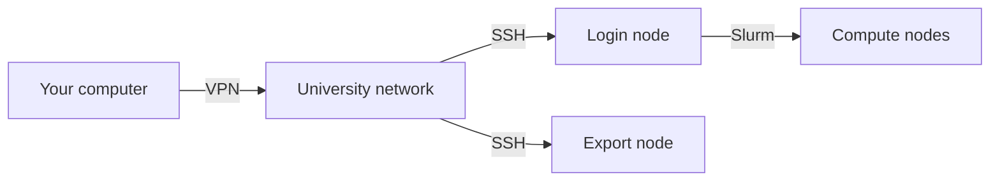

# sc-starter

A guide to the Scientific Computing (SC) cluster of Leipzig University,
for people who know their way around Python or R and have so far stayed
away from the cluster. It sets up your computer on Linux, macOS or
Windows, explains how Slurm runs your code and how your project gets to
the cluster, and has seven code-alongs from the social sciences that run
in minutes. sc-starter, the small tool in this repository, uploads a
project, starts it as Slurm jobs and brings the results back. The guide
also shows each step without it.

The guide is best read on its website,
<https://juhehehe.github.io/sc-starter/>. The same pages are in the folders
of this repository.



## Where to start

| I want to … | Read … |
|---|---|
| set everything up, once | [Set up your computer](docs/basics/setup.md) |
| understand how work on the cluster goes | [Working on the cluster](docs/basics/working-on-the-cluster.md), [How Slurm works](docs/slurm/how-slurm-works.md) |
| submit a first job by hand | [Your first job](docs/slurm/first-job.md) |
| copy data to and from the cluster | [Copying files](docs/project/copying-files.md) |
| keep my packages the same on the cluster | [Packages: uv and renv](docs/project/packages.md) |
| let sc-starter do the steps | [Install sc-starter](docs/sc-starter/install.md), [Working with sc-starter](docs/sc-starter/working-with-sc-starter.md) |
| run a model many times, with other settings or seeds | [python-topic-model](examples/python/python-topic-model/), [r-topic-model](examples/r/r-topic-model/), [r-segregation](examples/r/r-segregation/) |
| run something that takes longer than a job may | [python-long-run](examples/python/python-long-run/) |
| use a GPU | [python-embeddings](examples/python/python-embeddings/), [python-classifier](examples/python/python-classifier/), [python-bertopic](examples/python/python-bertopic/) |
| bring my own project to the cluster | [Bring your own project](docs/sc-starter/bring-your-own-project.md) |
| find out why something went wrong | [Troubleshooting](docs/reference/troubleshooting.md) |
| look up a command | the [cheat sheet](docs/reference/cheat-sheet.md) |
| look up partitions, GPUs and limits | [The cluster at a glance](docs/reference/cluster-at-a-glance.md) |
| keep my account on the cluster tidy | [Keep your account tidy](docs/reference/keep-your-account-tidy.md) |

## What is in this repository

| Folder | What it holds |
|---|---|
| [`docs/basics/`](docs/basics/) | setting up your computer, the terminal, how work on the cluster goes |
| [`docs/slurm/`](docs/slurm/) | job scripts and Slurm, from a first job to GPUs |
| [`docs/project/`](docs/project/) | copying files, Git, and packages with uv and renv |
| [`docs/sc-starter/`](docs/sc-starter/) | sc-starter: installing it, working with it, its commands |
| [`docs/reference/`](docs/reference/) | cheat sheet, the cluster at a glance, troubleshooting, glossary |
| [`examples/`](examples/) | the seven code-alongs, each with its finished files |
| [`first-jobs/`](first-jobs/) | the finished job scripts of the Slurm pages |
| `src/`, `tests/` | sc-starter and its tests |
| `site/` | the start page, the stylesheet and the build of the website |

## The code-alongs

Each code-along is a folder of its own. Its README builds the project
step by step, from an empty folder to the results, and the finished
files are next to it. [`examples/`](examples/) lists all seven, with what
each computes and what it shows about the cluster.

## How sc-starter works

You install it once, as [Install sc-starter](docs/sc-starter/install.md) shows.
That installs only the tool, a few files of Python, not the guide or the
code-alongs. Then, in the folder of a project on your computer:

| Command | What it does |
|---|---|
| `sc-starter check` | can this computer reach the cluster? |
| `sc-starter submit` | upload what changed, then start `job.slurm`, one run per line of `runs.txt` |
| `sc-starter status` | how is each run doing? |
| `sc-starter log` | what did a run print? |
| `sc-starter pull` | bring `results/` and the output files back |
| `sc-starter push` | only upload this folder, without starting a job |

Each command makes one to three short SSH calls (`submit` looks what the
cluster has, uploads what changed and submits). On Linux and macOS the
connection stays open for 30 minutes after your last command, as set up
in the setup guide; on Windows it closes at once. Nothing keeps running
on your computer. The job script `job.slurm` stays yours: it says what to
book and what to run, and the examples explain every line of theirs.

For each job, `sc-starter` keeps a note in the folder `.sc-starter/` of
the project: the job ID, the time, and copies of the job script and
`runs.txt`. `status` and `log` read it to know your last job. The folder
stays on your computer and out of git.

## Getting help

- [Troubleshooting](docs/reference/troubleshooting.md) lists the messages you may
  see, what they mean, and what to do.
- SC support helps with your account, the cluster and jobs: the form
  **Request support** in the [SC portal](https://portal.sc.uni-leipzig.de/request-support).
- Problems with sc-starter or this repository: an
  [issue on GitHub](https://github.com/juhehehe/sc-starter/issues).

## Working on the guide

The guide is also a website, built with [Zensical](https://zensical.org/)
from the Markdown files in `docs/` and `examples/`. The start page and the
stylesheet belong to the website alone and live in `site/`; the build
fetches the fonts and makes the tooltips from `docs/reference/glossary.md`. With
[uv](https://docs.astral.sh/uv/), in this folder:

```bash
uv run --group docs site/build.py          # build it into site/_site/ and check every link
uv run --group docs site/build.py serve    # preview it at http://127.0.0.1:8001
```

While the preview runs, run the first command again after a change. In
lists, indent by four spaces per level: GitHub shows that the same, and
the website needs it. The build says where a list is not so.

The code of the tool and of the examples is checked with Ruff, docstrings
included (`uv run ruff format`, `uv run ruff check`). The R code of the
examples follows the tidyverse style guide; with R and the packages
styler and lintr, `.lintr` in this folder sets the rules:

```bash
Rscript -e 'styler::style_dir("examples", dry = "fail"); lintr::lint_dir("examples")'
```

## Licence

MIT, see [LICENSE](LICENSE). The data in the examples come with their own
licences, named in each example's README.
