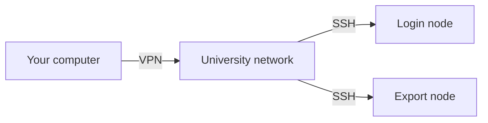
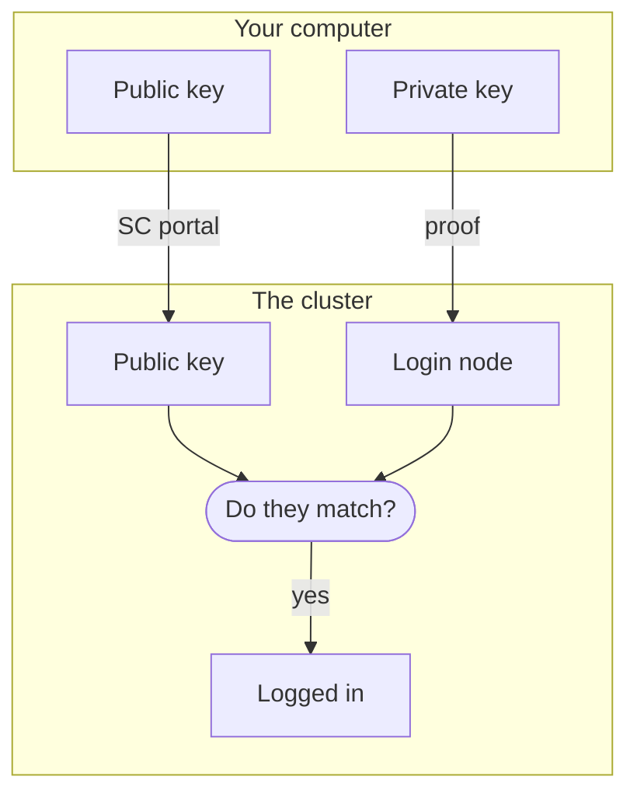

# Set up your computer

This page shows you how to connect your computer to the cluster. At the
end, `ssh sc-login` logs you in to the cluster without a password. It
works on Linux, on macOS 12 or newer and on Windows 10 or 11.

**Time:** 60 min · **Waiting:** until SC approves your account

## How your computer reaches the cluster



The cluster accepts connections only from inside the university network.
From elsewhere, you first connect to the university's VPN. SSH then
carries your commands to the cluster. It comes with Linux, macOS and
Windows. An SSH key proves who you are, so that you do not need a
password. On the cluster, you use two of its servers: one to start your
work and one to copy files.

## Before you start

You need your university login and password. If you have not used a
terminal before, [Working in the terminal](terminal.md) explains the
basics.

## 1. Apply for access

You log in to the cluster with your university login. Before that works,
the Scientific Computing team (SC) has to approve your account.

1. Log in to the SC portal: <https://portal.sc.uni-leipzig.de>
2. If you have not applied yet, fill in the form Request SC
   infrastructure. Say in two sentences what you want to compute and what
   you need, for example "many CPU jobs with 4 cores and 16 GB each" or
   "one GPU for a few hours". Someone at SC reviews the request by hand.
3. If the portal asks you to accept the terms of use, accept them.

**Check:** the portal shows your request as approved.

After the approval, it can take a few hours until the cluster has set up
your account. Go on with steps 2 to 5 in the meantime. Step 6 shows
whether everything is ready.

## 2. Connect to the university network

On campus, with a network cable or eduroam, your computer is already in
the university network. Test whether it reaches the cluster:

=== "Linux"

    ```bash title="Your computer"
    timeout 5 bash -c '</dev/tcp/login01.sc.uni-leipzig.de/22' 2>/dev/null && echo reachable || echo "not reachable"
    ```

    It prints `reachable`, or `not reachable` after at most 5 seconds.

=== "macOS"

    ```bash title="Your computer"
    nc -z -G 5 login01.sc.uni-leipzig.de 22 2>/dev/null && echo reachable || echo "not reachable"
    ```

    It prints `reachable`, or `not reachable` after at most 5 seconds.

=== "Windows"

    ```powershell title="Your computer"
    Test-NetConnection login01.sc.uni-leipzig.de -Port 22 -InformationLevel Quiet
    ```

    It prints `True` if your computer reaches the cluster. If not, it
    takes a while, may print warnings and ends with `False`.

If your computer reaches the cluster, go on to step 3. If not, connect
the VPN.

### Connect the VPN

The VPN asks for your university login and password. Only one device can
use your VPN account at a time, so disconnect your phone first.

=== "Linux"

    The VPN program for Linux is OpenConnect. Install it once with your
    package manager, for example:

    ```bash title="Your computer"
    sudo apt install openconnect      # Debian, Ubuntu
    sudo dnf install openconnect      # Fedora
    sudo pacman -S openconnect        # Arch
    ```

    Then connect, in a terminal of its own. Replace `YOUR_LOGIN` with your
    university login. Students write `@studserv.uni-leipzig.de` instead of
    `@uni-leipzig.de`.

    ```bash title="Your computer"
    sudo openconnect --protocol=anyconnect --authgroup=1-Standard-Uni \
      --user=YOUR_LOGIN@uni-leipzig.de vpn.uni-leipzig.de
    ```

    OpenConnect first asks for the password of your computer, because of
    `sudo`, and then for your university password. Leave this terminal
    open. The VPN stays connected as long as OpenConnect runs, and Ctrl+C
    ends it.

=== "macOS"

    The VPN program for macOS is the Cisco Secure Client, formerly called
    AnyConnect. Use it instead of the VPN settings built into macOS, which
    the university's computing centre (URZ) does not support. The URZ
    explains how to install and use it, with pictures, on the page
    [VPN on macOS](https://www.urz.uni-leipzig.de/servicedesk-und-hilfe/hilfe-zu-unseren-services/netz-und-zugang/hilfe-vpn-zugang-zum-uni-netz-vpn-webvpn/vpn-zugang-unter-apple-macos).

    Connect with these values:

    - Server: `vpn.uni-leipzig.de`
    - Group: `1-Standard-Uni`
    - Username: `YOUR_LOGIN@uni-leipzig.de`, with your university login.
      Students write `YOUR_LOGIN@studserv.uni-leipzig.de`.
    - Password: your university password.

=== "Windows"

    The VPN program for Windows is the Cisco Secure Client, formerly
    called AnyConnect. The university's computing centre (URZ) explains
    how to install and use it, with pictures, on the page
    [VPN on Windows](https://www.urz.uni-leipzig.de/servicedesk-und-hilfe/hilfe-zu-unseren-services/netz-und-zugang/hilfe-vpn-zugang-zum-uni-netz-vpn-webvpn/vpn-zugang-unter-microsoft-windows).

    Connect with these values:

    - Server: `vpn.uni-leipzig.de`
    - Group: `1-Standard-Uni`
    - Username: `YOUR_LOGIN@uni-leipzig.de`, with your university login.
      Students write `YOUR_LOGIN@studserv.uni-leipzig.de`.
    - Password: your university password.

**Check:** run the test from the start of this step again, in a second
terminal on Linux. It now prints `reachable`, or `True` on Windows.

??? fix "If your computer still does not reach the cluster"
    Check that the VPN program says that it is connected, and that no other
    device of yours uses the VPN at the same time.

    On Linux, the networks that Docker creates can cover addresses of the
    university network. If Docker runs on your computer, stop it and try
    again. The SC page
    [Compute clusters via SSH](https://www.sc.uni-leipzig.de/03_System_access/Cluster/)
    explains a lasting fix under "Troubleshooting connection issues".

    [Troubleshooting](../reference/troubleshooting.md#the-cluster-is-not-reachable)
    describes more causes.

## 3. Create an SSH key

Your *SSH key* is a pair of files that belong together, like a lock and
its key. The *public key* is the lock. Its file name ends in `.pub`, and
you can give it to anyone. In step 4 you upload it, and the cluster adds
it to your account. The *private key* is the key that opens this lock. It stays
on your computer, and you never give it to anyone. When you connect, your
computer proves that it has the private key without sending it.



The private key is protected by a *passphrase*, a password for the key
file. If someone copied the file, they could not use it without the
passphrase. Choose several words that you use nowhere else, as SC asks,
and keep them in a password manager.

=== "Linux"

    ```bash title="Your computer"
    ssh-keygen -t ed25519 -a 100 -f ~/.ssh/id_ed25519_sc -C "sc-leipzig"
    ```

=== "macOS"

    ```bash title="Your computer"
    ssh-keygen -t ed25519 -a 100 -f ~/.ssh/id_ed25519_sc -C "sc-leipzig"
    ```

=== "Windows"

    Windows 10 and 11 come with SSH. Check that it is there:

    ```powershell title="Your computer"
    (Get-Command ssh).Source
    ```

    It prints `C:\Windows\System32\OpenSSH\ssh.exe`.

    - If it says that the term `ssh` is not recognized, add SSH. Open
      Settings, then System on Windows 11 or Apps on Windows 10, then
      Optional features. Add OpenSSH Client and open a new PowerShell
      window.
    - If it prints a path under `C:\Program Files\Git`, the SSH of Git for
      Windows comes first. It cannot use the SSH agent of Windows. Ask for
      help before you go on.

    Then create the key:

    ```powershell title="Your computer"
    ssh-keygen -t ed25519 -a 100 -f "$HOME\.ssh\id_ed25519_sc" -C "sc-leipzig"
    ```

`ssh-keygen` asks twice for the passphrase. Nothing shows while you type.
`-t ed25519` chooses the type of key, and `-a 100` makes guessing the
passphrase slower. `-f` names the file, and `-C` adds a note that helps
you recognise the key later. If it asks `Overwrite (y/n)?`, answer `n`.
You made this key before and can keep it.

!!! check
    List the two files of the key:

    === "Linux"

        ```bash title="Your computer"
        ls ~/.ssh/id_ed25519_sc ~/.ssh/id_ed25519_sc.pub
        ```

        It prints both names, without an error.

    === "macOS"

        ```bash title="Your computer"
        ls ~/.ssh/id_ed25519_sc ~/.ssh/id_ed25519_sc.pub
        ```

        It prints both names, without an error.

    === "Windows"

        ```powershell title="Your computer"
        Get-ChildItem "$HOME\.ssh\id_ed25519_sc*" | Select-Object Name
        ```

        It lists `id_ed25519_sc` and `id_ed25519_sc.pub`.

### Turn on the SSH agent

The *SSH agent* is a small program on your computer that keeps your key
unlocked, so that you do not type the passphrase for every connection.

=== "Linux"

    On many systems the agent already runs. Find out:

    ```bash title="Your computer"
    ssh-add -l
    ```

    - If it prints `The agent has no identities.` or a list of keys, the
      agent runs. Go on to step 4.
    - If it prints `Could not open a connection to your authentication
      agent.` or `Error connecting to agent`, turn the agent on:

        ```bash title="Your computer"
        systemctl --user enable --now ssh-agent.socket
        echo 'export SSH_AUTH_SOCK="$XDG_RUNTIME_DIR/ssh-agent.socket"' >> ~/.bashrc
        ```

        The first line starts the agent now and after every restart. The
        second tells new terminals where to find it. Then open a new
        terminal.

    **Check:** in the new terminal, `ssh-add -l` prints `The agent has no
    identities.` The agent runs, and your key goes into it at your first
    login in step 6.

    If `systemctl` answers that `ssh-agent.socket` does not exist, your
    system starts the agent in another way. Copy the message and ask for
    help.

    On Linux, the agent forgets the key when you shut down. After each
    restart, you type the passphrase once, at your first connection.

=== "macOS"

    Your Mac runs an SSH agent by itself. Hand it the key, and let it keep
    the passphrase in the keychain:

    ```bash title="Your computer"
    ssh-add --apple-use-keychain ~/.ssh/id_ed25519_sc
    ```

    It asks for the passphrase and then prints `Identity added`. From now
    on, the keychain unlocks the key for you, even after a restart.

    **Check:** `ssh-add -l` prints one line that ends with
    `sc-leipzig (ED25519)`.

=== "Windows"

    On Windows, the agent is a service that is switched off at first.
    Switching it on needs administrator rights, once. Open the Start menu,
    type `PowerShell`, right-click Windows PowerShell and choose Run as
    administrator. In that window, paste:

    ```powershell title="Your computer"
    Get-Service ssh-agent | Set-Service -StartupType Automatic
    Start-Service ssh-agent
    ```

    It prints nothing. Close the administrator window and go back to your
    normal one. If the university manages your computer and you have no
    administrator rights, ask your IT support to switch on the service
    OpenSSH Authentication Agent.

    **Check:** `Get-Service ssh-agent` shows `Running` in the column
    `Status`.

    Then hand the key to the agent:

    ```powershell title="Your computer"
    ssh-add "$HOME\.ssh\id_ed25519_sc"
    ```

    It asks for the passphrase and then prints `Identity added`. The agent
    keeps the key from now on, even after a restart.

    **Check:** `ssh-add -l` prints one line that ends with
    `sc-leipzig (ED25519)`.

## 4. Upload the public key

1. Log in to the SC portal: <https://portal.sc.uni-leipzig.de>
2. Click your profile card, then the paperclip symbol.
3. Choose the file `id_ed25519_sc.pub` and save. Upload only the file that
   ends in `.pub`, never the one without.

The file is in the folder `.ssh` in your user folder. File dialogs often
hide this folder, because its name starts with a dot:

=== "Linux"

    In the file dialog, press Ctrl+H to show hidden folders.

=== "macOS"

    The file dialog does not show the folder `.ssh`. Put a copy of the
    public key on your desktop first:

    ```bash title="Your computer"
    cp ~/.ssh/id_ed25519_sc.pub ~/Desktop/
    ```

    In the file dialog, press Cmd+D to get to the desktop. After the
    upload, remove the copy:

    ```bash title="Your computer"
    rm ~/Desktop/id_ed25519_sc.pub
    ```

=== "Windows"

    In the file dialog, type `%USERPROFILE%\.ssh` into the address bar at
    the top and press Enter. Windows may hide the ending `.pub` and show
    the file as the type Microsoft Publisher or PUB File. That is the right
    file.

!!! check
    Show the public key:

    === "Linux"

        ```bash title="Your computer"
        cat ~/.ssh/id_ed25519_sc.pub
        ```

    === "macOS"

        ```bash title="Your computer"
        cat ~/.ssh/id_ed25519_sc.pub
        ```

    === "Windows"

        ```powershell title="Your computer"
        Get-Content "$HOME\.ssh\id_ed25519_sc.pub"
        ```

    It prints one line that starts with `ssh-ed25519` and ends with
    `sc-leipzig`. The portal now shows the same line. Step 6 shows whether
    the cluster accepts the key.

## 5. Write the SSH settings

Each computer of the cluster is called a *node*. You use two of them, and
both see the same files:

- The *login node*, `login01.sc.uni-leipzig.de`, is where you log in,
  start jobs and look at them. This guide calls it `sc-login`.
- The *export node*, `export01.sc.uni-leipzig.de`, is where files are
  copied to and from the cluster. This guide calls it `sc-export`.

SSH reads its settings from a file called `config` in the folder `.ssh`.
The commands below write the two short names into this file, together
with your login and your key. After this step, `ssh sc-login` is all you
type to log in.

First type this line and press Enter. Then type your university login,
the short one without `@`, and press Enter again:

=== "Linux"

    ```bash title="Your computer"
    printf 'Your university login: '; read -r SC_USER
    ```

=== "macOS"

    ```bash title="Your computer"
    printf 'Your university login: '; read -r SC_USER
    ```

=== "Windows"

    ```powershell title="Your computer"
    $SC_USER = Read-Host "Your university login"
    ```

In the same window, paste this block and press Enter:

=== "Linux"

    ```bash title="Your computer"
    if grep -qs '^Host sc-login' ~/.ssh/config; then
      echo "Already set up; nothing changed."
    elif [ -z "$SC_USER" ]; then
      echo "Run the line above first, in this terminal."
    else
      { cat <<EOF
    Host sc-login
        HostName login01.sc.uni-leipzig.de
    Host sc-export
        HostName export01.sc.uni-leipzig.de
    Host sc-*
        User $SC_USER
        IdentityFile ~/.ssh/id_ed25519_sc
        IdentitiesOnly yes
        HostKeyAlgorithms ssh-ed25519,ecdsa-sha2-nistp256,rsa-sha2-512,rsa-sha2-256
        AddKeysToAgent yes
        ControlMaster auto
        ControlPath ~/.ssh/cm-%r@%h:%p
        ControlPersist 30m
        ServerAliveInterval 120

    EOF
        [ ! -f ~/.ssh/config ] || cat ~/.ssh/config
      } > ~/.ssh/config.new && mv ~/.ssh/config.new ~/.ssh/config && chmod 600 ~/.ssh/config && echo "Written to ~/.ssh/config"
    fi
    ```

=== "macOS"

    ```bash title="Your computer"
    if grep -qs '^Host sc-login' ~/.ssh/config; then
      echo "Already set up; nothing changed."
    elif [ -z "$SC_USER" ]; then
      echo "Run the line above first, in this window."
    else
      { cat <<EOF
    Host sc-login
        HostName login01.sc.uni-leipzig.de
    Host sc-export
        HostName export01.sc.uni-leipzig.de
    Host sc-*
        User $SC_USER
        IdentityFile ~/.ssh/id_ed25519_sc
        IdentitiesOnly yes
        HostKeyAlgorithms ssh-ed25519,ecdsa-sha2-nistp256,rsa-sha2-512,rsa-sha2-256
        IgnoreUnknown UseKeychain
        UseKeychain yes
        AddKeysToAgent yes
        ControlMaster auto
        ControlPath ~/.ssh/cm-%C
        ControlPersist 30m
        ServerAliveInterval 120

    EOF
        [ ! -f ~/.ssh/config ] || cat ~/.ssh/config
      } > ~/.ssh/config.new && mv ~/.ssh/config.new ~/.ssh/config && chmod 600 ~/.ssh/config && echo "Written to ~/.ssh/config"
    fi
    ```

=== "Windows"

    ```powershell title="Your computer"
    $config = "$HOME\.ssh\config"
    $key = "$HOME\.ssh\id_ed25519_sc" -replace '\\', '/'
    if ((Test-Path $config) -and (Select-String -Path $config -Pattern '^Host sc-login' -Quiet)) {
        "Already set up; nothing changed."
    } elseif (-not $SC_USER) {
        "Run the line above first, in this window."
    } else {
        $old = if (Test-Path $config) { [IO.File]::ReadAllText($config) } else { "" }
        $new = "Host sc-login`n" +
            "    HostName login01.sc.uni-leipzig.de`n" +
            "Host sc-export`n" +
            "    HostName export01.sc.uni-leipzig.de`n" +
            "Host sc-*`n" +
            "    User $SC_USER`n" +
            "    IdentityFile `"$key`"`n" +
            "    IdentitiesOnly yes`n" +
            "    HostKeyAlgorithms ssh-ed25519,ecdsa-sha2-nistp256,rsa-sha2-512,rsa-sha2-256`n" +
            "    ServerAliveInterval 120`n`n"
        [IO.File]::WriteAllText($config, $new + $old)
        "Written to $config"
    }
    ```

    The block saves the file as UTF-8. SSH cannot read a file saved as
    UTF-16, which happens easily on Windows, for example in Notepad or
    with `>` in PowerShell.

It prints `Written to` and the name of the file. The block puts the
settings at the top of the file and keeps everything that was in it
before. SSH uses the first value it finds, so the top is the right place.
On Linux and macOS, `chmod 600` then lets only you read and change the
file, because SSH refuses settings that others could change. If the
block prints `Already set up; nothing changed.`, the settings are there
from an earlier try. The short names exist only in this file on your
computer. Elsewhere, such as in the SC documentation, you see the full
addresses of the nodes instead.

??? behind "The settings, line by line"
    `Host sc-login` and `Host sc-export` start the settings for each short
    name, and `HostName` gives the real address of the server. The lines
    under `Host sc-*` apply to both:

    - `User` is your university login, so that you do not have to type it.
    - `IdentityFile` and `IdentitiesOnly` tell SSH to use this key for the
      cluster and no other.
    - `HostKeyAlgorithms` makes the server show its ED25519 fingerprint,
      the one that step 6 lists, even where an older SSH would show
      another.
    - `AddKeysToAgent` hands the key to the SSH agent at the first
      connection. On macOS, `UseKeychain` lets the agent take the
      passphrase from the keychain.
    - The three lines that start with `Control` keep a connection open for
      30 minutes after your last command. Further commands reuse it and
      start without delay. The SSH of Windows cannot do this, so the
      Windows settings leave these lines out. They also leave out
      `AddKeysToAgent`, because on Windows you hand the key to the agent
      yourself in step 3.
    - `ServerAliveInterval` sends a short signal every two minutes, so that
      a connection you are not using stays open.

    The manual [ssh_config](https://man.openbsd.org/ssh_config) explains
    every setting.

!!! check
    Ask SSH which settings it uses for `sc-login`:

    === "Linux"

        ```bash title="Your computer"
        ssh -G sc-login | grep -E '^(user|hostname|identityfile) '
        ```

        ```text title="Output"
        user YOUR_LOGIN
        hostname login01.sc.uni-leipzig.de
        identityfile ~/.ssh/id_ed25519_sc
        ```

    === "macOS"

        ```bash title="Your computer"
        ssh -G sc-login | grep -E '^(user|hostname|identityfile) '
        ```

        ```text title="Output"
        user YOUR_LOGIN
        hostname login01.sc.uni-leipzig.de
        identityfile ~/.ssh/id_ed25519_sc
        ```

    === "Windows"

        ```powershell title="Your computer"
        ssh -G sc-login | Select-String '^(user|hostname|identityfile) '
        ```

        ```text title="Output"
        user YOUR_LOGIN
        hostname login01.sc.uni-leipzig.de
        identityfile C:/Users/YOU/.ssh/id_ed25519_sc
        ```

    It shows your login, the address of the login node and your key.

## 6. Log in for the first time

```bash title="Your computer"
ssh sc-login
```

The first time, SSH does not know the server yet. It shows the server's
*fingerprint*, a short code that belongs to this server alone, and asks
whether to continue:

```text title="Output"
The authenticity of host 'login01.sc.uni-leipzig.de (…)' can't be established.
ED25519 key fingerprint is: SHA256:3saqgn+bVpG3PyG7mtwM2nPQY0NfK9auNCxLCWb85wQ
This key is not known by any other names.
Are you sure you want to continue connecting (yes/no/[fingerprint])?
```

Do not type `yes`. Instead, paste the fingerprint that SC publishes for
login01, and SSH compares the two for you:

```text title="Your computer"
SHA256:3saqgn+bVpG3PyG7mtwM2nPQY0NfK9auNCxLCWb85wQ
```

If they match, SSH continues and saves the fingerprint on your computer.
From then on, it checks the fingerprint at every connection and refuses
to connect if it changes, as
[Troubleshooting](../reference/troubleshooting.md#remote-host-identification-has-changed)
describes. If SSH answers
`Please type 'yes', 'no' or the fingerprint:`, they do not match. Type
`no` and ask SC. The SC page
[SSH host keys](https://www.sc.uni-leipzig.de/03_System_access/SSH/)
lists the fingerprints of all servers.

=== "Linux"

    SSH then asks for the passphrase of your key, not for your university
    password. Nothing shows while you type.

=== "macOS"

    SSH does not ask for your passphrase, because the keychain has it.

=== "Windows"

    On Windows, the line with the fingerprint reads
    `ED25519 key fingerprint is SHA256:…`, with a dot at the end.

    SSH does not ask for your passphrase, because the agent has the key.

    On Windows 10 version 1809, the question ends in `(yes/no)?` and takes
    no fingerprint. Then compare the code after `fingerprint is` with the
    one above, character by character, and type `yes` only if they are the
    same.

The cluster greets you with a welcome screen and a report on your storage.
A warning that the connection "is not using a post-quantum key exchange
algorithm" is harmless. It concerns the server, and SC has to update it.

You are now on the login node. Everyone who uses the cluster shares it.

!!! danger "Do not compute on the login node"
    Do not run your scripts on the login node, not even briefly to try
    something out. The [SC usage policy](https://www.sc.uni-leipzig.de/00_Misc/policies/User%20policy.en/)
    allows only "file management, resource allocation, job submission and
    monitoring" there, and short tests such as printing a version number.
    Your scripts run as jobs, which
    [How Slurm works](../slurm/how-slurm-works.md) explains.

!!! check
    On the cluster, type:

    ```bash title="Cluster"
    ls -ld ~
    sinfo -s
    ```

    `ls -ld ~` prints one line that ends with
    `/home/sc.uni-leipzig.de/YOUR_LOGIN`, so your home directory exists.
    `sinfo -s` prints a table of the partitions:

    ```text title="Output"
    PARTITION     AVAIL  TIMELIMIT   NODES(A/I/O/T) NODELIST
    …
    cpu-xeonv3*      up 2-00:00:00       18/61/1/80 t[001-080]
    cpu-zen3         up 2-00:00:00        30/1/1/32 paul[01-32]
    …
    ```

    The star marks the partition your jobs use if you name none. Leave the
    cluster with `exit`.

??? fix "If something is off"
    - SSH asks for `YOUR_LOGIN@login01.sc.uni-leipzig.de's password`. The
      cluster does not accept your key yet. Press Ctrl+C, check step 4,
      wait a few minutes and try again.
    - SSH says `Could not chdir to home directory`, or `sinfo -s` shows
      only the line with the column names. Your account is approved but
      not ready yet. Wait a few hours and log in again.
    - SSH says `Permission denied` and the connection closes. Your account
      is not approved yet, as described in step 1.

    [Troubleshooting](../reference/troubleshooting.md#connecting-to-the-cluster) describes more
    messages.

### Connect to the export node once

Introduce your computer to the export node in the same way:

```bash title="Your computer"
ssh sc-export true
```

Answer the question about the fingerprint with the one for export01:

```text title="Your computer"
SHA256:5lwMCnUQYG50VHNRKULsTdcF1tHGm+FZ8duSEJTppNA
```

`true` is a command that does nothing. Apart from the question about the
fingerprint, and perhaps the warning about the post-quantum key exchange,
nothing appears, and you are back at your prompt.

**Check:** `ssh sc-login hostname` runs a single command on the login
node and prints its internal name, without asking for anything.

```bash title="Your computer"
ssh sc-login hostname
```

```text title="Output"
login01.sc.intern.uni-leipzig.de
```

## Further reading

- [Compute clusters via SSH](https://www.sc.uni-leipzig.de/03_System_access/Cluster/)
  in the SC documentation, with help for connection problems.
- [VPN access to the university network](https://www.urz.uni-leipzig.de/servicedesk-und-hilfe/hilfe-zu-unseren-services/netz-und-zugang/hilfe-vpn-zugang-zum-uni-netz-vpn-webvpn)
  from the university's computing centre.
- [Connecting securely to an HPC cluster](https://hpc-carpentry.github.io/hpc-intro/11-connecting.html),
  a workshop lesson by HPC Carpentry.
- [SSH keys](https://docs.ycrc.yale.edu/clusters-at-yale/access/ssh/)
  at the Yale Center for Research Computing, where the comparison with a
  lock and its key comes from.
