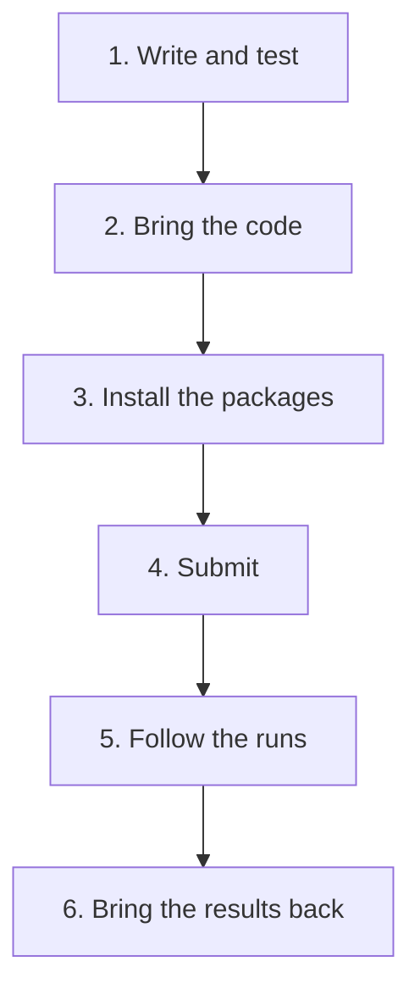

# Working on the cluster

This page explains how work on the cluster goes, from your computer to
the cluster and back. Each step links to the page that shows it with the
commands you type.

## How the cluster runs your code

You do not sit at the cluster and run your code there. You log in to the
login node, and from there you hand your work to Slurm as a job. The job waits in a queue until a compute node has room,
and then runs there on its own, without you. Everything it prints goes
into a file that you read afterwards. So a job cannot ask you anything,
and Slurm stops it at its time limit.

To try something out on a compute node first, you can also start an
interactive job, which gives you a terminal there.
[Interactive jobs](../slurm/interactive-jobs.md) shows how. SC also runs Jupyter
at <https://lab.sc.uni-leipzig.de> and RStudio at
<https://rstudio.sc.uni-leipzig.de>, in the browser and like the cluster
only from the university network. This guide does not use them.

A project goes through six steps, from your computer to the cluster and
back:

## 1. Write and test the code on your computer

You write your code on your computer, in your usual editor, and test it
there on a small part of the data. Errors show up much faster on your
own computer than on the cluster, where every job first waits in a
queue.

Keep everything that belongs to the project in one folder: code, job
scripts, the list of packages and, if they are small, the data. The SC
usage policy does not allow editors that work directly on the cluster,
such as the remote mode of VS Code. You edit on your computer and copy
the files over.

## 2. Bring the code to the cluster

There are two common ways to get your project onto the cluster.

The simplest is to copy the folder with `scp`. You type the command on
your computer, and the files travel through the export node.
[Your first job](../slurm/first-job.md#submitting-the-job) copies a first folder
this way. `scp` copies everything in the folder, including the packages
in `.venv` and any large data, so delete those from the copy or leave
them out. [Copying files to and from the cluster](../project/copying-files.md)
explains `scp` and `rsync`, which can leave folders out.

The other way is Git. You upload your project from your computer to a
service such as GitHub. On the cluster, you download it from there once,
and after each change you fetch the new version.
[Git: your code on your computer and on the cluster](../project/git.md) explains
how.

## 3. Install the packages, once

Your code needs the same packages on the cluster as on your computer, in
the same versions. For Python, the program uv installs them from the
project's lock file. For R, the package renv does the same.
[Packages: uv and renv](../project/packages.md) explains both.

Installing packages counts as computing, so it must not happen on the
login node. Instead, a second job script, `setup.slurm`, installs them in
a job of its own, the *setup job*, which you submit once. Wait until the
setup job has finished before you submit the runs, so that no run starts
before its packages are there.

## 4. Submit the job

You hand the job script to Slurm. On the cluster, in the project folder,
the command `sbatch` submits a job and prints its *job ID*. Slurm puts
the job in its queue and starts it as soon as a node has room for it. To
run a script many times with different settings, you submit it as a
*job array*, with one run for each setting.
[Your first job](../slurm/first-job.md) submits a first job, and
[Many runs: job arrays](../slurm/job-arrays.md) a job array.

## 5. Follow the runs

Once a job is submitted, it no longer needs your computer. You can log
out, disconnect the VPN and come back later. On the cluster,
`squeue --me` lists your jobs that are waiting or running, and
`sacct -X -j` with the job ID shows the state of each run, also after it
has ended. Everything a run prints, including error messages, ends up in
its *output file* in the project folder, which you read with `cat`. To
stop a job, type `scancel` and its job ID.
[Following the job](../slurm/first-job.md#following-the-job) explains these
commands and what they print.

## 6. Bring the results back

Your results are now on the cluster, in the project folder. Copy them to
your computer with `scp`, as
[Your first job](../slurm/first-job.md#bringing-the-output-back) does with its
output file.

## Rules to keep in mind

Everyone shares the login node. Use it to start jobs and look at them,
never to run your computations. Copy files through the export node,
`sc-export`, because the login node stops long transfers.

A simple editor on the cluster, such as `nano`, is allowed for small changes. But
changes made there are easily overwritten when you copy the project
again, and with Git they make `git pull` stop with a conflict.

## What sc-starter does for you

sc-starter does steps 2, 4, 5 and 6, and it also submits the setup job of
step 3. You type its commands on your computer, in the folder of your
project. `sc-starter submit` copies the project to the cluster and
submits the job, with `--array` for each line of `runs.txt`.
`sc-starter status` shows the runs, and `sc-starter pull` brings the
results back. To stop a job, you still use `scancel`.

You still write your code, your job script and your setup script
yourself. [Working with sc-starter](../sc-starter/working-with-sc-starter.md) explains
each command.

## Further reading

- [Introduction to High Performance Computing](https://www.sc.uni-leipzig.de/01_HPC_basics/HPC_intro/)
  and [Workload Manager Slurm](https://www.sc.uni-leipzig.de/05_Instructions/Slurm/)
  in the SC documentation.
- [Scheduler fundamentals](https://hpc-carpentry.github.io/hpc-intro/13-scheduler.html),
  a workshop lesson by HPC Carpentry on submitting and following jobs.
- [Quick start user guide](https://slurm.schedmd.com/quickstart.html) in
  the Slurm documentation.
- [Running jobs](https://docs.rc.fas.harvard.edu/kb/running-jobs/) at
  Harvard's research computing centre, a clear guide to job scripts.
