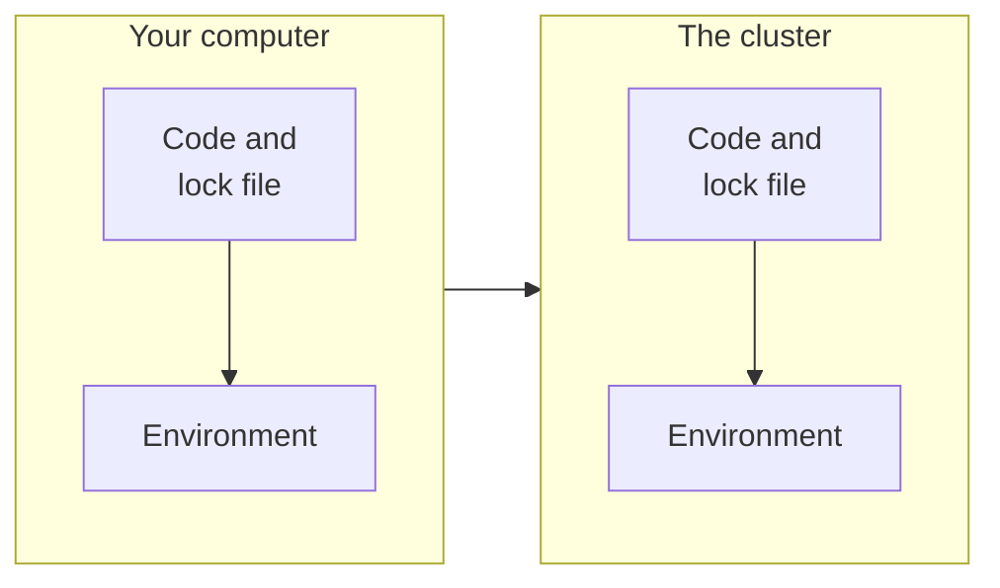

# Packages: uv and renv

This page explains uv for Python and renv for R, which install the same
packages in the same versions on your computer and on the cluster.

Most projects use *packages*, code that other people have written and
shared, such as numpy for calculations in Python or ggplot2 for figures
in R. Each package exists in many versions, and a script that works with
one version may fail with another. On the cluster, your code therefore
needs the same packages in the same versions as on your computer.

A *package manager* takes care of this. It installs the packages of a
project and writes down their exact versions, so that another computer
can install exactly the same ones. Python and R each have their own:
*uv* for Python and *renv* for R. Both work in the same way.

## What a package manager keeps in a project

A package manager gives each project its own *environment*, a folder with
the packages of this project. Two projects can then use different
versions of the same package without getting in each other's way.

It also writes a *lock file*, a list of the exact version of every
package in the environment. The list includes the packages that your
packages need in turn. The lock file is a small text file. It goes with
your code to the cluster, and the package manager there installs exactly
the versions it lists. The environment itself stays on each computer,
because it can be built again from the lock file at any time.



These are the files of each package manager:

| | Python with uv | R with renv |
|---|---|---|
| the packages you asked for | `pyproject.toml` | the `library()` lines of your scripts |
| the lock file | `uv.lock` | `renv.lock` |
| the version of the language | `.python-version` | recorded in `renv.lock`; on the cluster, the R module |
| files that switch the environment on | none | `.Rprofile`, `renv/activate.R`, `renv/settings.json` |
| the environment | the hidden folder `.venv` | the folder `renv/library` |

Everything in this table except the environment belongs in Git and goes
to the cluster. [Git](git.md) explains how to leave the environment out.

## Getting the package manager

=== "Python"

    uv installs Python itself, in the version that a project asks for, so
    you do not need to install Python separately. Find out whether uv is
    already there:

    ```bash title="Your computer"
    uv --version
    ```

    If it prints `uv` and a version number, you have it. If the terminal
    does not know the command, install uv:

    === "Linux"

        ```bash title="Your computer"
        curl -LsSf https://astral.sh/uv/install.sh | sh
        ```

        Then close the terminal and open a new one, so that it finds uv.

    === "macOS"

        ```bash title="Your computer"
        curl -LsSf https://astral.sh/uv/install.sh | sh
        ```

        Then close the terminal and open a new one, so that it finds uv.

    === "Windows"

        ```powershell title="Your computer"
        powershell -ExecutionPolicy ByPass -c "irm https://astral.sh/uv/install.ps1 | iex"
        ```

        Then close PowerShell and open it again, so that it finds uv.

    **Check:** `uv --version` prints a version number.

=== "R"

    You need R on your computer, from
    [CRAN](https://cran.r-project.org/). Many people also use RStudio,
    from [Posit](https://posit.co/download/rstudio-desktop/). renv is an R
    package. Install it once, in R:

    ```r title="R"
    install.packages("renv")
    ```

## Starting a project

=== "Python"

    In a new, empty project folder, in a terminal:

    ```bash title="Your computer"
    uv init --bare --python 3.12
    uv python pin 3.12
    uv add numpy matplotlib
    ```

    `uv init` writes `pyproject.toml`, and `uv python pin` writes
    `.python-version`. `uv add` installs packages into `.venv` and adds
    them to `pyproject.toml`, with their newest version as the lowest
    allowed one, such as `numpy>=2.5.4`. It also writes `uv.lock`.

    **Check:** `uv run python -c "import numpy; print(numpy.__version__)"`
    prints the version of numpy.

=== "R"

    Open R in the project folder. In RStudio, choose File › New Project ›
    Existing Directory and select the folder. On Linux and macOS, you can
    also move into the folder in a terminal with `cd` and type `R`. On
    Windows, use RStudio, because `R` in PowerShell is a short form of
    another command. If you want the packages to install
    faster on the cluster, first choose the package server described in
    [Faster installation for R](#faster-installation-for-r). Then type:

    ```r title="R"
    renv::init()
    ```

    `renv::init()` writes the files from the table above and records the
    packages that your scripts already use.

    **Check:** `renv::status()` reports that the project is in a
    consistent state.

## Adding a package

=== "Python"

    ```bash title="Your computer"
    uv add pandas
    ```

    uv installs the package, adds it to `pyproject.toml` and updates
    `uv.lock`. If you need exactly one version, add it to the name, as in
    `uv add numpy==2.5.4`. `uv remove pandas` takes a package out again.

=== "R"

    Install the package, load it in your script with `library()`, and
    record it in the lock file:

    ```r title="R"
    install.packages("stm")
    renv::snapshot()
    ```

    `renv::snapshot()` records only the packages that one of your scripts
    loads. A package that you installed but do not load yet stays out of
    the lock file.

## Running your code

=== "Python"

    ```bash title="Your computer"
    uv run run.py
    ```

    `uv run` starts the script with the project's Python and packages. You
    do not need to switch anything on. uv always uses the project of the
    folder you are in.

=== "R"

    In RStudio, open the project, open the script and click Source. On
    Linux and macOS, you can also run it in a terminal, in the project
    folder:

    ```bash title="Your computer"
    Rscript run.R
    ```

    In both cases, R starts in the project folder. `.Rprofile` then
    switches the project's environment on, and R finds the project's
    packages. On Windows, PowerShell finds `Rscript` only after you add
    the folder `bin` of R, such as `C:\Program Files\R\R-4.5.2\bin`, to
    the `PATH`, the list of folders in which the terminal looks for
    programs.

## On the cluster: the setup job

On the cluster, the packages are installed by a *setup job*, a job script
of its own that you submit once before the runs. Installing packages
counts as computing, so it must not happen on the login node. And if
every run installed its own packages, many runs would write into the same
folder at the same time. [How Slurm works](../slurm/how-slurm-works.md) explains job
scripts in general.

=== "Python"

    The setup job of the Python code-alongs ends with these lines:

    ```bash title="Part of setup.slurm"
    export PATH="$HOME/.local/bin:$PATH"
    if ! command -v uv > /dev/null; then
      curl -LsSf https://astral.sh/uv/0.12.10/install.sh | env UV_NO_MODIFY_PATH=1 sh
    fi
    uv sync --locked
    ```

    The first line tells bash where uv lives. The `if` block installs uv
    for your account if it is not there yet. The last line installs
    exactly the versions from `uv.lock` into `.venv` in the project
    folder. `--locked` makes it stop with an error if `uv.lock` does not
    match `pyproject.toml`, instead of changing the lock file.

    The job script of the runs then starts your script with `uv run`, as
    on your computer:

    ```bash title="Part of job.slurm"
    export PATH="$HOME/.local/bin:$PATH"
    uv run --no-sync python run.py 10
    ```

    The first line tells bash where uv is. `--no-sync` makes uv take the
    packages that the setup job installed as they are. Without it, each
    run would first check `.venv` against `uv.lock` and install what is
    missing, during the job.

=== "R"

    On the cluster, R itself is a module. The setup job of the R code-alongs ends with
    these lines:

    ```bash title="Part of setup.slurm"
    module load R/4.5.2-gfbf-2025b
    export LC_ALL=C.UTF-8
    export MAKEFLAGS="-j${SLURM_CPUS_PER_TASK}"
    Rscript -e 'renv::restore(prompt = FALSE)'
    ```

    The first line switches on R 4.5.2. The second avoids warnings about
    the language settings. The third lets R compile packages with all
    cores of the job, if a package comes as source code. The last starts
    R in the project folder.
    There, `.Rprofile` installs renv itself the first time, and
    `renv::restore()` installs the packages from `renv.lock` into
    `renv/library`.

    The job script of the runs loads the same module and starts your
    script with `Rscript`:

    ```bash title="Part of job.slurm"
    module load R/4.5.2-gfbf-2025b
    Rscript run.R 10
    ```

    Do not add `--vanilla` to `Rscript`. It would skip `.Rprofile`, and R
    would not find the project's packages.

The code-along
[Topic model in Python](../../examples/python/python-topic-model/README.md)
contains a complete setup job and job script.

## The commands you use

=== "Python"

    | Command | What it does |
    |---|---|
    | `uv add PACKAGE` | installs a package and records it |
    | `uv remove PACKAGE` | removes a package |
    | `uv run script.py` | runs a script with the project's Python and packages |
    | `uv sync` | installs exactly what `uv.lock` lists, for example after you downloaded a project |
    | `uv sync --locked` | the same, but stops if `uv.lock` and `pyproject.toml` do not match |
    | `uv lock` | writes `uv.lock` again, for example after you edited `pyproject.toml` by hand |

=== "R"

    | Command | What it does |
    |---|---|
    | `install.packages("NAME")` | installs a package into the project |
    | `renv::snapshot()` | writes the versions of the packages you use into `renv.lock` |
    | `renv::restore()` | installs exactly the versions in `renv.lock`, for example on the cluster |
    | `renv::status()` | shows whether the lock file and the installed packages match |

## Faster installation for R

The lock file also names the server that the packages come from. Unless
you choose another one, this is CRAN. CRAN offers ready-made packages for
Windows and macOS, but for Linux, which the cluster runs, it offers only
the source code. The cluster then has to compile every package. That
works, but it takes time: for the 33 packages of the code-along
[Topic model in R](../../examples/r/r-topic-model/README.md), about 7
minutes.

The Posit Package Manager offers ready-made packages for Linux. To use
it, set it as the server in R before you install your packages:

```r title="R"
options(repos = c(CRAN = "https://p3m.dev/cran/latest"))
```

renv then records this server in `renv.lock`, and on the cluster it
installs the ready-made packages. With such a lock file, the same 33
packages took a few seconds. [p3m.dev](https://p3m.dev/) explains the
service.

## Where the packages are stored

Both package managers keep one shared store of downloaded packages for
all your projects, and fill each environment from it. This saves time and
space when several projects use the same packages. On the cluster, uv
keeps its store in `~/.cache/uv` and renv in `~/.cache/R/renv`.
[Keep your account tidy](../reference/keep-your-account-tidy.md) shows how to see and clean
these folders.

## If you know pip, venv or conda

In Python, pip installs packages, and venv creates an environment for
them. uv does both and keeps the lock file up to date for you. conda also
manages environments and versions of Python, with its own collections of
packages. The code-alongs in this guide use uv, because it uses the
standard files of Python packages and records exact versions.

## Further reading

- [Getting started](https://docs.astral.sh/uv/getting-started/) and
  [Projects](https://docs.astral.sh/uv/concepts/projects/) in the uv
  documentation.
- [Using uv on a cluster](https://handbook.eng.kempnerinstitute.harvard.edu/s1_high_performance_computing/development_and_runtime_envs/using_uv_env.html)
  in the handbook of the Kempner Institute at Harvard.
- [Introduction to renv](https://rstudio.github.io/renv/articles/renv.html)
  in the renv documentation.
