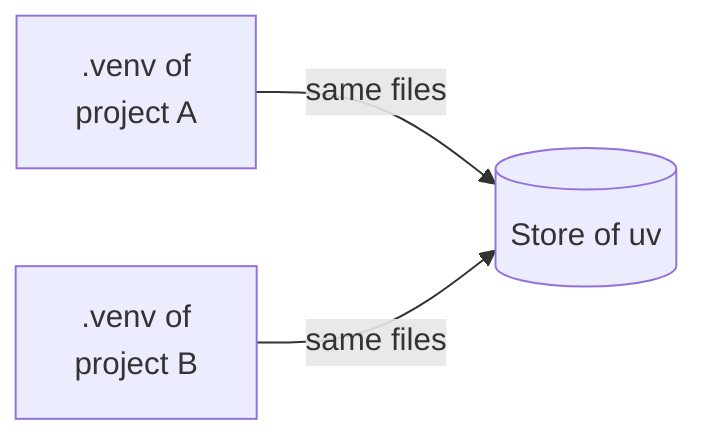

# Keep your account tidy

This page shows where things are on the cluster, how to see how much
space they take and how to clean up.

Your home directory on the cluster holds 100 GB. Packages, models and
results add up quickly. `FOLDER_NAME` stands for the name of a project
folder, `FILE` for the name of a file and `PACKAGE` for the name of a
package.

## Where things are

| What | Where on the cluster | Used by |
|---|---|---|
| your projects, with their results and output files | `~/sc-projects/FOLDER_NAME` | one folder per project |
| the Python packages of a project | `.venv` in the project folder | that project |
| the R packages of a project | `renv/library` in the project folder | that project |
| the packages that uv downloaded | `~/.cache/uv` | all Python projects |
| uv itself, and the versions of Python it installed | `~/.local/bin`, `~/.local/share/uv` | all Python projects |
| the packages that renv downloaded | `~/.cache/R/renv` | all R projects |
| models from Hugging Face | `~/.cache/huggingface` | all projects |

Keep what a project installs inside its own folder. Do not install
packages for your whole account: no `pip install --user`, no
`install.packages()` outside a project with renv, and no base
environment of conda. uv and renv already
give each project its own `.venv` or `renv/library`, filled from a shared
store.

This store is why removing a project frees less space than you might
expect. A package file in a `.venv` is the same file on disk as the one
in the store of uv, and `renv/library` holds only links into the store
of renv. The space is freed only when the store is cleaned up as well, as
described below.



## Seeing how much space things take

How full your home directory is:

```bash title="Your computer"
ssh sc-export sc_quotas
```

It prints a box with these lines, among others:

```text title="Output"
🏠 Home   17.8G/100G (18%)
🛠  Work2  1k/5T (0%) | 1/10,000,000 files (0%) | del 0/0
```

How much space each store and each project takes, in one command:

```bash title="Your computer"
ssh sc-export 'du -sh .cache/uv .cache/R/renv .cache/huggingface .local/share/uv sc-projects/*'
```

It prints one line for each, here shortened:

```text title="Output"
6.5G	.cache/uv
252M	.cache/R/renv
1.5G	.cache/huggingface
154M	.local/share/uv
175M	sc-projects/python-bertopic
385M	sc-projects/python-classifier
5.7M	sc-projects/r-topic-model
```

If you have no R project yet, `du` also says that it cannot access
`.cache/R/renv`. That is fine.

Keep the stores first in the command, and measure everything in one
command. `du` counts a file that lies in two folders only once, in the
first folder where it finds it, and it does not follow the links of renv
into its store. With the stores first, each project shows
only what is its own, such as results, output files and data. That is
what removing the project frees.

Which models Hugging Face keeps, with the command `hf`, which every
Python project with transformers or sentence-transformers has in its
`.venv`:

```bash title="Your computer"
ssh sc-export sc-projects/python-embeddings/.venv/bin/hf cache ls
```

It lists each model with its size, here two of them:

```text title="Output"
ID                                         SIZE LAST_ACCESSED LAST_MODIFIED REFS
---------------------------------------- ------ ------------- ------------- ----
model/distilbert/distilbert-base-uncased 268.7M 3 hours ago   3 hours ago   main
model/sentence-transformers/all-MiniL...  91.6M 4 hours ago   4 hours ago   main
```

## Cleaning up

### A project you no longer need

`sc-starter pull` brings back only `results/` and the output files. Look
first at what else is in the project folder on the cluster:

```bash title="Your computer"
ssh sc-export ls sc-projects/FOLDER_NAME
```

Copy any other file you want to keep to your computer yourself, such as
the last save `checkpoint.pickle` of
[Runs longer than the time limit](../../examples/python/python-long-run/README.md):

```bash title="Your computer"
scp sc-export:sc-projects/FOLDER_NAME/FILE .
```

Then bring back the results and remove the folder:

```bash title="Your computer"
sc-starter pull
ssh sc-export rm -rI sc-projects/FOLDER_NAME
```

`rm -rI` asks once before it deletes. Type `y` and press Enter.

**Check:** `ssh sc-export ls sc-projects` no longer lists the folder.

### Packages in the store of uv

Never delete files in `~/.cache/uv` yourself. The documentation of uv
says that this is never safe. Let uv do it:

```bash title="Your computer"
ssh sc-export .local/bin/uv cache prune
ssh sc-export .local/bin/uv cache clean PACKAGE
```

`uv cache prune` removes only what uv no longer needs.
`uv cache clean PACKAGE` removes one
package from the store, and `uv cache clean` without a name removes all
of them.

A project that already has the package keeps working, because its
`.venv` holds the files too. For the same reason, cleaning the store frees
little while projects still use the packages. Remove the projects you no
longer need first, then clean the store. A new project downloads what it
needs again.

**Check:** Each command ends with what it removed: `Removed`, a number
of files and their size. If there was nothing to remove, `prune` says
`No unused entries found`, and `clean` says `No cache entries found`.

### A model of Hugging Face

Look first at what would be removed, then remove it:

```bash title="Your computer"
ssh sc-export sc-projects/python-embeddings/.venv/bin/hf cache rm model/distilbert/distilbert-base-uncased --dry-run
ssh sc-export sc-projects/python-embeddings/.venv/bin/hf cache rm model/distilbert/distilbert-base-uncased --yes
```

With `--dry-run`, the command only says what it would delete, such as
`About to delete 1 repo(s) totalling 268.7M.` With `--yes`, it deletes
and ends with `freed 268.7M`. A project that needs the model downloads it
again with its setup job.

### An R package in the store of renv

renv links each package from its store into the projects that use it. So
removing a package from the store also removes it from these projects.
The documentation of renv calls this "inherently destructive". The
command needs R, which the export node does not have, so you type it on
the login node, in the folder of a project that uses renv. It computes
nothing and only removes files.

```bash title="Your computer"
ssh sc-login
```

```bash title="Cluster"
cd sc-projects/r-topic-model
module load R/4.5.2-gfbf-2025b
Rscript -e 'renv::purge("shape", prompt = FALSE)'
exit
```

Afterwards, `library(shape)` fails in that project with
`there is no package called ‘shape’`, until you run its setup job again.

## Repairing a broken environment

If the packages of a project fail in ways you cannot explain, do not
repair them. Remove the project's environment and let the setup job
build it again. The store stays, so this is quick:

```bash title="Your computer"
ssh sc-export rm -rI sc-projects/FOLDER_NAME/.venv           # Python
ssh sc-export rm -rI sc-projects/FOLDER_NAME/renv/library    # R
sc-starter submit setup.slurm
```

Type the line for Python or the one for R, then the last line.

**Check:** When `sc-starter status` shows the setup job as `COMPLETED`,
submit the job that failed again. It no longer fails in the same way.

If it fails in the same way, the package is broken in the store itself,
and the rebuild took the broken files from there again. Remove the
package from the store, then rebuild the environment again, which this
time downloads the package anew. For Python, use
`ssh sc-export .local/bin/uv cache clean PACKAGE`. For R, use
`renv::purge` as described in
[An R package in the store of renv](#an-r-package-in-the-store-of-renv).

## Large data

Data that several projects use do not belong in each project folder.
[Copying files to and from the cluster](../project/copying-files.md#large-data)
shows how to copy them once, into a folder outside your projects. For
more than your home directory holds, SC offers workspaces, which
`sc_quotas` lists as `Work2`. The SC page
[Workspaces](https://www.sc.uni-leipzig.de/04_Data_Management/Workspaces/)
explains them.
