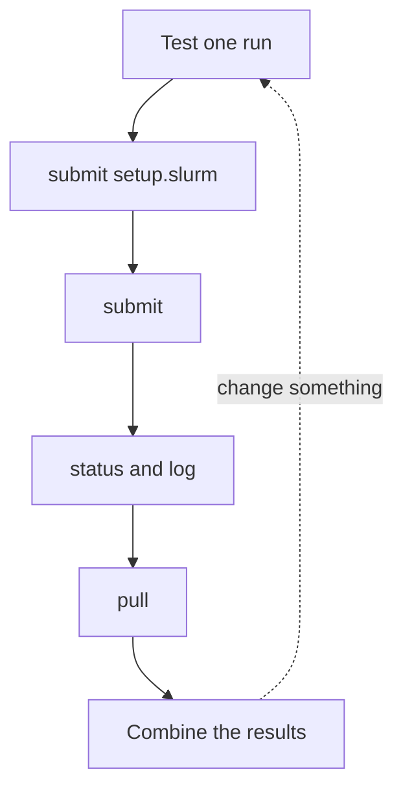

# Working with sc-starter

This page goes through the steps of sc-starter in the order of a project
and shows the commands that sc-starter saves you.

sc-starter is a small program that you run on your computer. It does not
compute anything itself. It copies your project folder to the cluster and
asks Slurm to run it. Later it shows you how the work is going and copies
the results back into your folder. Each step of sc-starter is a few SSH
commands that you could also type yourself.



You always type sc-starter commands in a terminal on your computer, in the
folder of your project.

## The project folder

A project is a folder on your computer that holds your code, your data and
a few small files that tell the cluster what to do. A project in Python
or R looks like this:

=== "Python"

    ```text title="my-project/"
    my-project/
    ├── run.py            one run: reads its setting, writes its result
    ├── runs.txt          one line per run
    ├── job.slurm         the job script for the runs
    ├── setup.slurm       the job script that installs the packages
    ├── pyproject.toml    the packages you asked for
    ├── uv.lock           their exact versions
    ├── .python-version   the version of Python
    ├── data/             the input data, if it is small
    ├── results/          one file per run, written by the runs
    ├── combine.py        puts the results together, on your computer
    ├── .venv/            the packages; never sent, the cluster builds its own
    └── .sc-starter/      sc-starter's notes, on your computer only
    ```

=== "R"

    ```text title="my-project/"
    my-project/
    ├── run.R             one run: reads its setting, writes its result
    ├── runs.txt          one line per run
    ├── job.slurm         the job script for the runs
    ├── setup.slurm       the job script that installs the packages
    ├── renv.lock         the packages and their exact versions
    ├── .Rprofile         switches the project's packages on
    ├── renv/             renv's files; its library is never sent
    ├── data/             the input data, if it is small
    ├── results/          one file per run, written by the runs
    ├── combine.R         puts the results together, on your computer
    └── .sc-starter/      sc-starter's notes, on your computer only
    ```

You choose the names of your scripts, your data and your other files.
These names are fixed, because sc-starter looks for them:

| Name | What sc-starter does with it |
|---|---|
| `job.slurm` | `sc-starter submit` starts it, once for each line of `runs.txt`, or once if there is no `runs.txt` |
| `runs.txt` | `submit` counts its lines and starts one run per line; `status` shows each run's line |
| any other `.slurm` file, such as `setup.slurm` | `sc-starter submit setup.slurm` starts it once |
| `results/` | `pull` brings it back; `push` never sends it |
| files ending in `.out` | Slurm's output files; `log` shows them, `pull` brings them back |
| `failed.txt` | `status` writes the numbers of the runs that did not complete into it |
| `.sc-starter/` | sc-starter keeps its notes on your jobs here |

[Bring your own project](bring-your-own-project.md) shows the rules that your code
has to follow and gives you job scripts to copy.

## The copy on the cluster

On the cluster, each project gets a folder with the same name inside the
folder `sc-projects` in your home directory, for example
`~/sc-projects/python-topic-model`. Use only letters, digits, dots,
hyphens and underscores in the name of the project folder, and give each
project a name of its own. Two folders with the same name share one copy
on the cluster.

The copy holds your files. It
also holds everything that is created on the cluster, such as the
packages that `setup.slurm` installs, the files in `results` and the
output files. The jobs run in this folder, so the relative paths in your
code work there as they do on your computer.

sc-starter never deletes anything in this folder. If you delete a file on
your computer, the copy on the cluster stays until you delete the whole
folder, as described in [Cleaning up](#cleaning-up).

## The usual course of a project

In commands, the first round looks like this:

```bash title="Your computer"
sc-starter check                # can your computer reach the cluster?
sc-starter submit setup.slurm   # install the packages on the cluster
sc-starter status               # wait until it shows COMPLETED
sc-starter submit               # start one run per line of runs.txt
sc-starter status               # see how the runs are doing
sc-starter pull                 # bring results/ and the output files back
```

The sections below explain each step and what can happen on the way.

## Before the first job

Test one run on your computer first. Take the first line of `runs.txt`
and type it in the terminal, with `uv run` in front for Python:

=== "Python"

    ```bash title="Your computer"
    uv run python run.py 5
    ```

=== "R"

    ```bash title="Your computer"
    Rscript run.R 5
    ```

It should run without an error and write its file into `results/`. An
error that shows up here takes seconds to find. On the cluster, the same
error shows up only after the job has waited in the queue.

## Checking the connection with `check`

```bash title="Your computer"
sc-starter check
```

```text title="Output"
sc-login: ok (login01)
sc-export: ok (export01)
Ready.
```

`check` connects to the login node and to the export node. If it does
not print `Ready.`, it says what is missing, such as the VPN.

## Uploading the project with `push`

```bash title="Your computer"
sc-starter push
```

```text title="Output"
Uploaded 10 files (1.7 MB) to sc-export:~/sc-projects/my-project
```

`push` brings the copy on the cluster up to date with your project
folder. `submit` does this by itself before every job, so you need `push`
only when you want the files on the cluster without running anything.

sc-starter first asks the cluster which files its copy has. It then sends
only the files that are new or have changed on your computer, packed into
one archive. A file on the cluster may have changed since the last
upload, for example because a job wrote to it. In that case sc-starter
stops and tells you which file it is, so that it never overwrites newer
work on the cluster.
[Troubleshooting](../reference/troubleshooting.md#the-cluster-has-a-newer-copy)
explains how to decide which copy to keep.

sc-starter leaves out what the cluster builds itself or writes itself:

- the folders `.git`, `.ssh`, `.venv` and `__pycache__`, wherever they are
- at the top of the project: `results/`, `failed.txt`, `.sc-starter/`,
  the output files, and the folders that renv keeps for your computer,
  such as `renv/library`

The cluster builds its own environment from your lock file. A link to a
file or folder outside the project is sent as the file or folder it
points to, so data that you link into the project arrives on the
cluster. Job scripts and `runs.txt` arrive with Unix line endings, even
if you wrote them on Windows.

??? behind "The same by hand"
    Without sc-starter, you would copy the files with `scp`. It sends
    every file each time and does not check for newer files on the
    cluster:

    ```bash title="Your computer"
    ssh sc-export mkdir -p sc-projects/python-topic-model
    scp -r data run.py runs.txt job.slurm setup.slurm pyproject.toml uv.lock .python-version sc-export:sc-projects/python-topic-model/
    ```

## Installing the packages with `submit setup.slurm`

```bash title="Your computer"
sc-starter submit setup.slurm
```

```text title="Output"
Uploaded 10 files (1.7 MB) to sc-export:~/sc-projects/my-project
Submitted job 28404223. See how it goes with `sc-starter status`.
```

If your project has a setup job, start it once. `submit` first sends
your project to the cluster, then starts the job.
Repeat `sc-starter status` until it shows the job as `COMPLETED`.
While the setup job waits in the queue or runs, `sc-starter submit`
does not start the runs. It does not notice a setup job that has ended
as `FAILED`, so check that the setup job shows `COMPLETED` before you
start the runs. If it ends as `FAILED`, `sc-starter log` shows
why. Fix the cause and start the setup job again.

Start the setup job again whenever the packages change, that is, after
`uv add` or `renv::snapshot()`. It installs only what is new.

## Starting the runs with `submit`

```bash title="Your computer"
sc-starter submit
```

```text title="Output"
Submitted job 28514701 with runs 1-6. See how it goes with `sc-starter status`.
```

`submit` first checks `runs.txt`. If a line is empty, is a comment or
continues on the next line, it tells you which line and stops. It then
sends what has changed in the project, so the cluster always runs what is
in your folder, and asks Slurm on the login node to run `job.slurm` once
for each line of `runs.txt`. Slurm calls this a *job array*. It is one
job with one job ID and several runs, and Slurm starts each run as soon
as a computer is free for it.

Each run needs to know which line of `runs.txt` is its own. Slurm tells
it its number in a variable called `SLURM_ARRAY_TASK_ID`, and `job.slurm`
reads the line with that number and runs it. This happens in your job
script, not inside sc-starter, so the job script also works without
sc-starter.

From now on, the job no longer needs your computer. You can close it and
disconnect the VPN. Slurm sends you an email when all runs have ended, if
`job.slurm` has the line `--mail-type=END,FAIL`.

??? behind "The same by hand"
    ```bash title="Your computer"
    ssh sc-login 'cd sc-projects/python-topic-model && sbatch --array=1-6 job.slurm'
    ```

    ```text title="Output"
    Submitted batch job 28514701
    ```

### Trying one run first with `submit --lines`

For a new project, try a single run before all of them, best the one
that takes longest. Write its number, which is its line in `runs.txt`,
into a file called `first.txt`. For run 1:

=== "Linux"

    ```bash title="Your computer"
    echo 1 > first.txt
    ```

=== "macOS"

    ```bash title="Your computer"
    echo 1 > first.txt
    ```

=== "Windows"

    ```powershell title="Your computer"
    Set-Content first.txt 1
    ```

    In Windows PowerShell, `echo 1 > first.txt` would save the file in
    a form that sc-starter cannot read.

Then start only that run:

```bash title="Your computer"
sc-starter submit --lines first.txt
```

When it has completed, look at its output and its result. If both are
right, start all runs with `sc-starter submit`. A project without
`runs.txt` has a single run anyway and skips this.

## Following the runs with `status` and `log`

```bash title="Your computer"
sc-starter status
```

```text title="Output"
Job 28514701: 4 COMPLETED, 2 RUNNING

run  state      exit  node  elapsed   command
1    COMPLETED  0:0   t010  00:00:53  python run.py 5
2    COMPLETED  0:0   t010  00:00:54  python run.py 10
3    COMPLETED  0:0   t010  00:01:02  python run.py 15
4    COMPLETED  0:0   t010  00:01:04  python run.py 20
5    RUNNING          t010  0:41      python run.py 25
6    RUNNING          t010  0:40      python run.py 30
```

`status` shows the last job that you started from this folder, with one
line per run: its state, its exit code, the node, how long it ran and its
line of `runs.txt`. It asks Slurm with `squeue` about runs that wait or
run, and with `sacct` about runs that have ended.
[The command reference](commands.md#status) explains the columns and all
states. To see what a run printed, give its number to `log`:

```bash title="Your computer"
sc-starter log 3
```

```text title="Output"
Run 3 on t010: python run.py 15
K = 15 done in 1.0 minutes
```

`log` finds the output file of a run by its name, which the line
`--output` in the job script sets. For a job without `runs.txt`, such as
the setup job, leave out the number. To look at an earlier job, give its
job ID, as in `sc-starter status 28404223`.

??? behind "The same by hand"
    ```bash title="Your computer"
    ssh sc-login squeue --me
    ssh sc-login sacct -X -j 28514701
    ssh sc-export cat sc-projects/python-topic-model/python-topic-model-28514701_3.out
    ```

## Bringing the results back with `pull`

```bash title="Your computer"
sc-starter pull
```

```text title="Output"
Pulled 19 files (0.0 MB) into this folder.
```

`pull` copies the folder `results` and the output files from the cluster
into your project folder, packed into one archive. Files with the same
name are replaced, and nothing else in your folder changes. You can pull
while runs are still working, and pull again later for the rest.

The output files lie at the top of your project folder, one per run. You
can delete them on your computer when you no longer need them.

??? behind "The same by hand"
    ```bash title="Your computer"
    scp -r 'sc-export:sc-projects/python-topic-model/results' .
    scp 'sc-export:sc-projects/python-topic-model/*.out' .
    ```

## When runs fail

If runs do not complete, `status` writes their numbers into the file
`failed.txt`. These are runs that ended as `FAILED`, `TIMEOUT` or
`OUT_OF_MEMORY`, and runs that you stopped, which show as `CANCELLED`. Find out why with
`sc-starter log` and the number of the run.
[Troubleshooting](../reference/troubleshooting.md#a-run-fails) lists the usual
causes:

- `FAILED`: an error in the script. Fix it on your computer and test the
  run there.
- `TIMEOUT`: the run needed more time than `--time` in `job.slurm`.
- `OUT_OF_MEMORY`: the run needed more memory than `--mem`.

Once no run of the job waits or runs any more, start only these runs
again:

```bash title="Your computer"
sc-starter submit --lines failed.txt
```

The run numbers are line numbers of `runs.txt`. If you need to change a
line, change it in place, without adding or removing lines, so that the
numbers still fit.

## Changing something and running again

Change your code on your computer, test one run there and start the job
again with `sc-starter submit`. sc-starter sends only the files that
have changed, and the job gets a new job ID.

The new runs write their result files under the same names as before, so
they replace the old ones, on the cluster and, after `pull`, on your
computer. To keep the old results, move the folder `results` out of the
project folder before you pull, for example to your desktop. A folder
with another name inside the project would be sent to the cluster with
the next job.

### Leave the files alone while runs wait

A run reads `runs.txt`, your scripts and your data when it starts, not
when you submit it. If you change these files while runs of a job are
still waiting, those runs start with the changed files. Wait until
`status` shows no `PENDING` run before you submit changed files. If you
need to change something at once, stop the job first.

## Stopping a job

sc-starter has no command to stop a job. Use Slurm's command `scancel`
with the job ID:

```bash title="Your computer"
ssh sc-login scancel 28514701
```

This stops all runs of the job, those still waiting and those running.
`status` then shows them as `CANCELLED`.

## Keeping track of your code

sc-starter keeps a note of each job in the folder `.sc-starter`, with
copies of `job.slurm` and `runs.txt` as they were when you submitted the
job. It does not keep your scripts. If you use [Git](../project/git.md), save a
commit before each job. Then you know later which version of your code
produced which results.

## Cleaning up

When you have your results, remove the project's copy from the cluster.
It holds the packages, the results and the output files:

```bash title="Your computer"
ssh sc-export rm -rI sc-projects/my-project
```

`rm -rI` asks once before it deletes. Type `y` and press Enter.
[Keep your account tidy](../reference/keep-your-account-tidy.md) shows how to see what else takes
up space, such as the stores of uv and renv.

## What sc-starter leaves to you

sc-starter does not decide what a run needs or what it does. All of that
is in your `job.slurm`, and sc-starter passes it to Slurm unchanged. It
does not install packages either. Your `setup.slurm` does that, in a job
on a compute node.

sc-starter does not watch your jobs. Check on them with
`sc-starter status`, or wait for the email that Slurm sends when a job has
finished. It also does not link jobs together. If one step of your work
needs the results of another, start the second job when the first has
completed.

It also does not store passwords or keys. It uses SSH as you set it up on
your computer, so it needs the VPN when you are off campus and your key in
the SSH agent. [Set up your computer](../basics/setup.md)
explains both.

## Further reading

- The [command reference](commands.md) lists every command with its
  options and messages.
- The Slurm documentation explains [sbatch](https://slurm.schedmd.com/sbatch.html),
  which starts jobs, and [job arrays](https://slurm.schedmd.com/job_array.html).
- [Workload Manager Slurm](https://www.sc.uni-leipzig.de/05_Instructions/Slurm/)
  in the SC documentation describes Slurm on the cluster in Leipzig.
- [Scheduler fundamentals](https://hpc-carpentry.github.io/hpc-intro/13-scheduler.html)
  by HPC Carpentry shows how to submit and follow jobs by hand.
