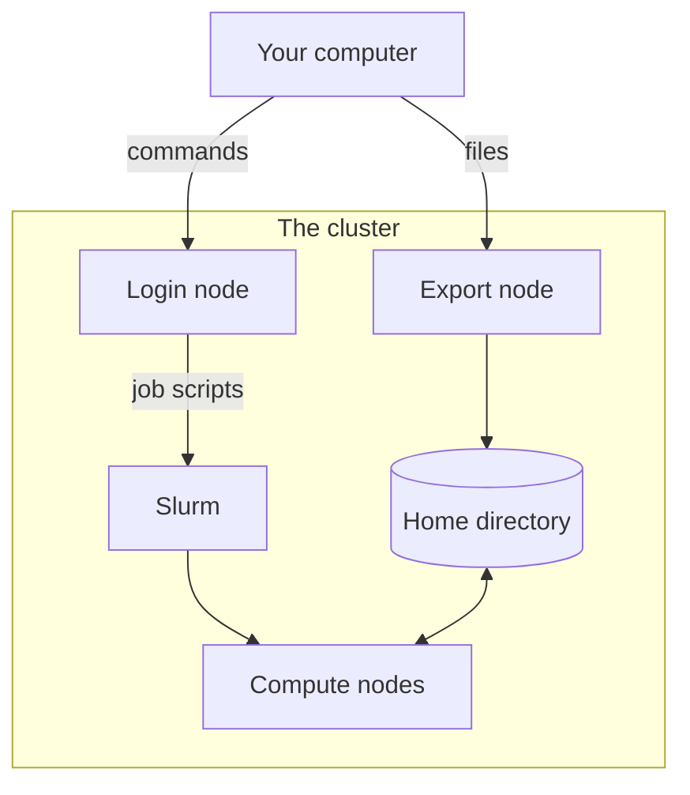

# How Slurm works

This page explains how Slurm decides where and when a job runs. On the
pages after it, you write small jobs yourself, submit them and read what
they printed.

The cluster has one node that you log in to, the login node, and many
*compute nodes*, which do the actual work. You do not start your scripts
on a compute node yourself. You describe the work in a *job script*, a
short text file, and hand it to *Slurm*, the program that shares the
compute nodes among everyone who uses the cluster. A piece of work that
you hand to Slurm is called a *job*. Slurm waits until a node has room,
runs the job there and saves everything the job prints in a file.

You copy files to and from the cluster through the export node. They end
up in your home directory, which all nodes of the cluster share, so the
login node and your jobs see them too.

## What a job asks for

Every job tells Slurm what it needs:

- a number of *cores*, the parts of a processor that each do one thing at
  a time. Most scripts in Python and R use one core.
- an amount of memory, such as 2 GB.
- a *time limit*, the longest the job may run, such as 20 minutes.
- if needed, a GPU, a processor that does many simple calculations at
  the same time.

Slurm reserves this for your job on one compute node, and the job cannot
use more. Each core comes with a share of the node's memory. If a job
asks for more memory than that share, Slurm books more cores to go with
it. [The cluster at a glance](../reference/cluster-at-a-glance.md#partitions) lists the memory per
core of each partition. If the job needs more memory than it asked for,
Slurm stops it with the state `OUT_OF_MEMORY`. If it is still running at its time
limit, Slurm stops it with the state `TIMEOUT`.

So ask for what your job needs, plus a margin. Do not ask for much more:
the more a job asks for, the longer it waits until a node has that much
room free. A job that names no time limit gets 1 hour, and a job that
names no memory gets 1 GB per core.

## Partitions and the queue

The compute nodes are grouped into *partitions*, groups of nodes of the
same kind. Most jobs go to `cpu-xeonv3`, the standard partition. Jobs
that need a GPU go to a partition with GPUs, such as `gpu-a30`.
[The cluster at a glance](../reference/cluster-at-a-glance.md) lists all partitions with their
nodes and limits.

When you submit a job, Slurm puts it in the *queue*, the list of jobs
that wait for a node. While it waits, the job is pending. As soon as a
node has room, the job is running. Small jobs often start within seconds.
Jobs that ask for a lot, or for a GPU, may wait for hours when the
cluster is busy.

## Further reading

- [Workload Manager Slurm](https://www.sc.uni-leipzig.de/05_Instructions/Slurm/)
  in the SC documentation, with the rules for jobs on this cluster.
- [Scheduler fundamentals](https://hpc-carpentry.github.io/hpc-intro/13-scheduler.html),
  a workshop lesson by HPC Carpentry.
- [Running jobs](https://docs.rc.fas.harvard.edu/kb/running-jobs/) at
  Harvard's research computing centre.
- [Submitting jobs](https://www.sherlock.stanford.edu/docs/getting-started/submitting/)
  on Sherlock, the cluster of Stanford University.
- [sbatch](https://slurm.schedmd.com/sbatch.html), the manual of every
  `#SBATCH` option, and [Job arrays](https://slurm.schedmd.com/job_array.html),
  both in the Slurm documentation.
