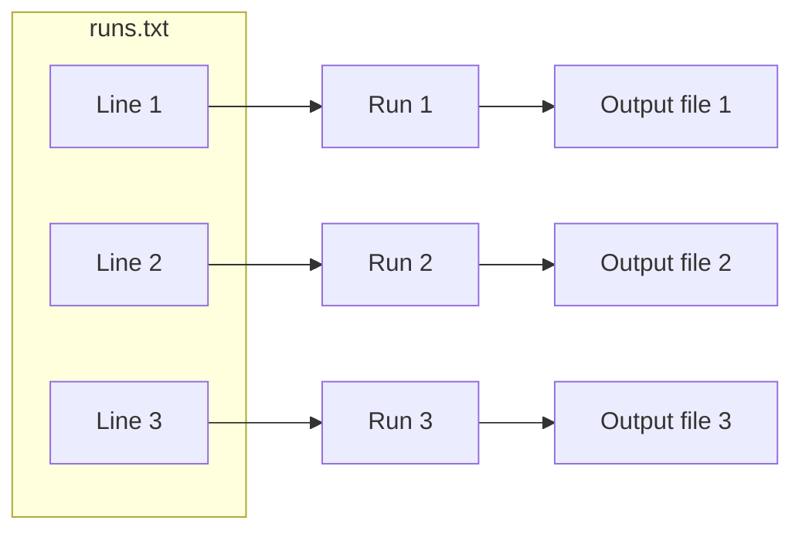

# Many runs: job arrays

This page shows how one job script runs several times with different
settings, with a small job of three runs.

Often you want to run the same script several times with different
settings, for example a model with 5, 10 and 20 topics. You do not need a
job script for each one. You submit one job with several runs, called a
*job array*. Each run gets its own cores, memory and time limit, and each
starts as soon as a node has room for it. Each run finds its number in
the environment variable `SLURM_ARRAY_TASK_ID`.



## The list of runs

The job scripts of the code-alongs in this guide use that number to pick
a line from a file called `runs.txt`. Each line of that file is the
command for one run, such as `python run.py 5` for a model with 5
topics. The small job on this page only prints its setting.

In the folder `first-jobs` on your computer, create a folder called
`hello-array`, and in it a file called `runs.txt`:

```text title="runs.txt"
echo "A model with 5 topics"
echo "A model with 10 topics"
echo "A model with 20 topics"
```

## The job script

Next to `runs.txt`, create a file called `job.slurm`, with the two parts
below.

```bash title="job.slurm"
#!/bin/bash
# Many runs of one job script: one run for each line of runs.txt.

#SBATCH --job-name=hello-array
#SBATCH --partition=cpu-xeonv3
#SBATCH --cpus-per-task=1
#SBATCH --mem=1G
#SBATCH --time=00:05:00
#SBATCH --output=%x-%A_%a.out
```

These lines are those of `hello.slurm`, except for the output file. Each
run of an array writes its own output file. In `--output=%x-%A_%a.out`,
`%A` is the job ID and `%a` the number of the run.

```bash title="job.slurm"
run=$(sed -n "${SLURM_ARRAY_TASK_ID}p" runs.txt)
[ -n "$run" ] || { echo "runs.txt has no line $SLURM_ARRAY_TASK_ID"; exit 1; }
echo "Run $SLURM_ARRAY_TASK_ID on $(hostname -s): $run"
bash -c "$run"
```

The first line reads the line of `runs.txt` with the number of this run
and keeps it in the variable `run`. In run 2, `"${SLURM_ARRAY_TASK_ID}p"`
becomes `"2p"`, and `sed -n "2p" runs.txt` prints line 2. The second line
ends the run with an error if `runs.txt` has no such line, so that it
shows up as `FAILED`. The third line writes the run and its node into the
output file. The last line runs the command.

**Check:** in the folder `hello-array`, `cat job.slurm` shows both parts,
and `cat runs.txt` the three lines. The finished files are also in this
repository, as
[first-jobs/hello-array/job.slurm](../../first-jobs/hello-array/job.slurm)
and [first-jobs/hello-array/runs.txt](../../first-jobs/hello-array/runs.txt).

## Submitting the runs

Copy the folder `hello-array` into the folder `first-jobs` on the cluster
and log in. On your computer, in the folder that contains `first-jobs`:

```bash title="Your computer"
scp -r first-jobs/hello-array sc-export:first-jobs/
ssh sc-login
```

A job script that runs one line of `runs.txt` per run needs `--array`,
with one number for each line. On the cluster:

```bash title="Cluster"
cd first-jobs/hello-array
sbatch --array=1-3 job.slurm
```

```text title="Output"
Submitted batch job 28514701
```

Slurm then runs the job script three times, as runs 1, 2 and 3. While
they wait or run, `squeue --me` lists each run with the job ID and its
number, such as `28514701_2`.

**Check:** once the runs are gone from the list, `ls` shows an output
file for each run:

```text title="Output"
hello-array-28514701_1.out  hello-array-28514701_2.out  hello-array-28514701_3.out  job.slurm  runs.txt
```

`cat hello-array-28514701_2.out` shows what run 2 printed:

```text title="Output"
Run 2 on t002: echo "A model with 10 topics"
A model with 10 topics
```

The first line comes from the job script, the second from the command in
line 2 of `runs.txt`. Type `exit` to leave the cluster.
