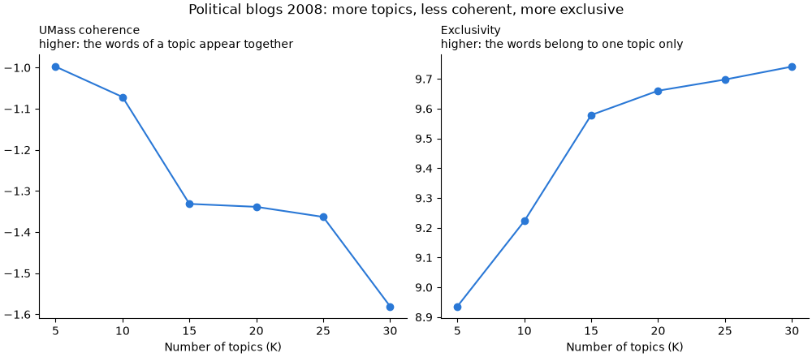

# Topic model in Python: finding the number of topics in political blogs

In this example you build a small research project from an empty folder
and run it on the cluster.

The project fits a topic model to 5,000 posts from six US political blogs
of 2008. A topic model finds groups of words that often appear together in
a collection of texts. Each group is a topic. You decide how many topics
the model looks for, and a common way to decide is to fit the model
several times and compare the fits. You will fit it six times, with 5,
10, 15, 20, 25 and 30 topics.

You write the code on your computer and test one fit there. Then the
cluster runs all six fits at the same time, and you bring the results back
to your computer to compare them.

The finished files are next to this page: [run.py](run.py),
[runs.txt](runs.txt), [job.slurm](job.slurm), [setup.slurm](setup.slurm)
and [combine.py](combine.py). If something does not work, you can compare
your files with them.

**Time:** 45 min

## Before you start

You need a computer that is set up for the cluster, as described in the
[setup guide](../../../docs/basics/setup.md), and sc-starter, as
[Install sc-starter](../../../docs/sc-starter/install.md) describes. When you type
`sc-starter check` in a terminal, it should print `Ready.`

You also need a code editor. [VS Code](https://code.visualstudio.com/) is
free and works on all three systems.

You do not need to install Python yourself. A program called *uv*, which
you installed for sc-starter, takes care of it.
[Packages: uv and renv](../../../docs/project/packages.md) explains what uv does.

## Plan the project

Before you write code, decide what one run of the project is. Here, one
run fits the model once, with one number of topics. The number of topics
is the only thing that changes from run to run. So the main script,
`run.py`, takes it as an *argument*: `python run.py 10` fits a model
with 10 topics.

Each run saves its result in a file of its own, in a folder called
`results`, with the number of topics in the name, such as
`results/k-10.csv`. Six runs that end at the same time would otherwise
overwrite each other's results. A last script, `combine.py`, puts the six
results side by side on your computer.

A fit takes about a minute. All six one after another would take a few
minutes, which still fits on your own computer. A real analysis would let
each model run longer and try more numbers of topics, and then the runs
take hours. On the cluster, the runs run side by side, so all six take no
longer than the longest one.

The cluster runs the script six times. A text file, `runs.txt`, lists the
six commands, one per line. A second file, `job.slurm`, tells the cluster
how much time, memory and computing power each run needs. You take these
values from a test on your own computer.

When the project is finished, the folder looks like this:

```text title="python-topic-model/"
python-topic-model/
├── data/poliblog5k.csv.gz   the blog posts
├── run.py                   fits one model
├── runs.txt                 the six commands for the cluster
├── job.slurm                what each run needs
├── setup.slurm              installs the packages on the cluster
├── combine.py               compares the six fits
├── pyproject.toml           the project's packages
├── uv.lock                  their exact versions
└── results/                 what the runs write
```

## Part 1: Build and test the project on your computer

### 1. Create the project

Open a terminal. Move to the folder where you keep your projects with
`cd` and the name of the folder, for example `cd Documents`. Then create
a folder for this project and move into it:

```bash title="Your computer"
mkdir python-topic-model
cd python-topic-model
```

All further commands on this page run in this folder. If you open a new
terminal later, move into the folder again with `cd`.

Now set up the folder as a Python project with uv. uv installs Python and
the packages a project needs. It keeps them inside the project folder, so
that different projects do not interfere with each other.

```bash title="Your computer"
uv init --bare --python 3.12
uv python pin 3.12
uv add tomotopy==0.14.0 numpy==2.5.4 matplotlib==3.11.2
```

The first command creates `pyproject.toml`, a short file that describes
the project. The second creates `.python-version`, which tells uv to use
Python 3.12 for this project, on your computer and later on the cluster.

The third command installs three packages. tomotopy fits topic models,
numpy does calculations with tables of numbers, and matplotlib draws
figures. The version numbers are fixed, so that your results match the ones shown here as closely as possible.

uv also writes a file called `uv.lock`. It records the exact version of
every package, including the packages that these three depend on. The
cluster will install exactly these versions. The packages themselves are
stored in a hidden folder called `.venv`, the project's *environment*.

Open the project folder in your editor. In VS Code, choose
File › Open Folder and select `python-topic-model`.

**Check:** Ask tomotopy for its version number:

```bash title="Your computer"
uv run python -c "import tomotopy; print(tomotopy.__version__)"
```

```text title="Output"
0.14.0
```

`uv run` starts a command with the project's Python and packages. You
will use it whenever you run something from this project on your computer.

### 2. Download the data

The data set is called poliblog5k. It holds 5,000 blog posts from the
time of the 2008 US presidential election, taken from three liberal and
three conservative blogs. It is a sample of the CMU 2008 Political Blog
Corpus (Eisenstein and Xing 2010). It comes with the R package stm, which
is published under the MIT licence.

Download the file into a new folder called `data`:

```bash title="Your computer"
curl -L --create-dirs -o data/poliblog5k.csv.gz https://raw.githubusercontent.com/juhehehe/sc-starter/main/examples/python/python-topic-model/data/poliblog5k.csv.gz
```

On Windows, type `curl.exe` instead of `curl`, because in PowerShell the
word `curl` starts a different command.

The file is a compressed table, 1.6 MB in size. Each row is one post, and
the column `words` holds its text. The text has already been prepared for
a topic model. Very common words such as "the" have been removed, and
each word has been cut down to its stem. The words are also sorted
alphabetically. A stem like `econom` stands for economy, economic and
economics. The order of the words does not matter here, because a topic
model only counts how often each word appears in a post. The other three
columns hold the blog, its political leaning and the day of the year.

**Check:** Count the posts and show the beginning of the first one:

```bash title="Your computer"
uv run python -c "import csv, gzip; posts = list(csv.DictReader(gzip.open('data/poliblog5k.csv.gz', 'rt'))); print(len(posts), 'posts'); print(posts[0]['blog'], posts[0]['rating'], posts[0]['day'], posts[0]['words'][:50])"
```

```text title="Output"
5000 posts
ha Conservative 182 acknowledg acknowledg across alreadi american anot
```

### 3. Write the model script

In your editor, create a new file in the project folder and save it as
`run.py`. You will add the code in five parts. Paste each part at the end
of the file.

The script uses a model called LDA (latent Dirichlet allocation, Blei et
al. 2003), a widely used topic model. LDA starts from a random guess of
which words belong to which topic and then improves this guess over many
rounds. The script runs 1,000 rounds, which is enough for 5,000 posts.

Start with the description of the script, the packages it needs and a
few fixed settings:

```python title="run.py"
"""One run of the topic model: fit LDA with K topics on the political blogs.

Usage: python run.py <K>
Writes results/k-<K>.csv with two quality measures and
results/k-<K>-topics.txt with the most probable words of each topic.
"""

import csv
import gzip
import os
import sys
import time
from pathlib import Path

import numpy as np
import tomotopy as tp

DATA = Path("data/poliblog5k.csv.gz")
RESULTS = Path("results")
# Rounds of Gibbs sampling; enough for 5,000 posts to settle.
ITERATIONS = 1000
# Both quality measures look at the top words of each topic.
TOP_WORDS = 10
```

The first six imports come with Python, the last two are the packages you
installed. `DATA` and `RESULTS` are
paths relative to the project folder, so they work on your computer and on
the cluster. `ITERATIONS` sets how many rounds the model trains.

Next, add a function that reads the posts. It opens the compressed file
and returns the words of each post:

```python title="run.py"
def read_posts(path):
    """Return the words of each post, one list per post."""
    with gzip.open(path, "rt", encoding="utf-8", newline="") as file:
        return [row["words"].split() for row in csv.DictReader(file)]
```

The script judges each fitted model by two measures. Coherence checks
whether the main words of a topic tend to appear in the same posts, and
tomotopy calculates it for you. Exclusivity checks whether the main words
of a topic belong to that topic alone. The next two functions calculate
exclusivity in the same way as the R package stm, so you can compare the
results with the R version of this example. You can use them without
following the details:

```python title="run.py"
def exclusivity(model):
    """Measure how much the top words of a topic belong to that topic only.

    The measure of exclusivity() in the R package stm, so that this example
    and r-topic-model report the same thing. Within each topic, every word
    gets two ranks: how frequent it is in the topic, and how exclusive (the
    share of the word's weight across all topics that lies in this topic).
    FREX combines both, with 70% weight on exclusivity. The score of a
    topic is the sum over its top words, at most 10; this returns the mean
    over topics.
    """
    weights = np.array([model.get_topic_word_dist(t) for t in range(model.k)])
    shares = weights / weights.sum(axis=0)
    frex = 1 / (0.7 / ranks(shares) + 0.3 / ranks(weights))
    top = np.argsort(-weights, axis=1)[:, :TOP_WORDS]
    return float(np.take_along_axis(frex, top, axis=1).sum(axis=1).mean())


def ranks(values):
    """Return the rank of each value within its row, from 1/n for the lowest to 1."""
    return (values.argsort(axis=1).argsort(axis=1) + 1) / values.shape[1]
```

The fourth part does the actual work. It reads the number of topics, fits
the model, measures it and saves the results:

```python title="run.py"
def main():
    """Fit the model with the K given on the command line, and save it."""
    if len(sys.argv) != 2 or not sys.argv[1].isdigit():
        sys.exit("Usage: python run.py <number of topics>")
    k = int(sys.argv[1])

    # The model with K topics and a fixed seed, so that the same K gives
    # the same topics, and the posts it learns from.
    model = tp.LDAModel(k=k, seed=1)
    for words in read_posts(DATA):
        model.add_doc(words)

    # Left alone, tomotopy starts one worker per core of the whole node, and
    # they crowd onto the cores this job booked. So as many workers as
    # job.slurm books; one on your own computer.
    cores = int(os.environ.get("SLURM_CPUS_PER_TASK", "1"))
    started = time.perf_counter()
    model.train(iterations=ITERATIONS, workers=cores)
    minutes = (time.perf_counter() - started) / 60

    # UMass coherence: do the top words of a topic appear in the same posts?
    coherence = tp.coherence.Coherence(model, coherence="u_mass", top_n=TOP_WORDS)

    # The two measures and the time, as one row of results/k-<K>.csv.
    RESULTS.mkdir(exist_ok=True)
    with open(RESULTS / f"k-{k:02d}.csv", "w", newline="") as file:
        writer = csv.writer(file)
        # The job, so that combine.py can tell results of an earlier job apart.
        writer.writerow(["k", "coherence", "exclusivity", "minutes", "job"])
        writer.writerow(
            [
                k,
                round(coherence.get_score(), 4),
                round(exclusivity(model), 4),
                round(minutes, 2),
                os.environ.get("SLURM_ARRAY_JOB_ID", ""),
            ]
        )

    # The seven most probable words of each topic, to read what it is about.
    topics = [
        f"Topic {t + 1:2d}: "
        + ", ".join(word for word, _ in model.get_topic_words(t, top_n=7))
        for t in range(k)
    ]
    (RESULTS / f"k-{k:02d}-topics.txt").write_text("\n".join(topics) + "\n")
    print(f"K = {k} done in {minutes:.1f} minutes")
```

Four things in this part matter for running the script on the cluster.

The number of topics comes from the command line. `sys.argv` holds the
words you type after the name of the script, so `python run.py 10` sets
`k` to 10. This is what allows one script to do six different fits.

The model starts from a fixed *seed*, `seed=1`. A seed is the starting
number for the random guesses of the model, so the same seed always
produces the same guesses. With the same seed and the same number of
topics, you get the same model on your computer and on the cluster.

The script uses only as many processor cores as the cluster gave it. The
cluster tells each run how many cores it has in a variable called
`SLURM_CPUS_PER_TASK`. Without this line, tomotopy would try to use all 32
cores of the computer it runs on, although the run was given only one. On
your computer the variable does not exist, and the script uses one core.

Each run saves its results in files of its own. The number of topics is
part of each file name, for example `results/k-10.csv`. Six runs that
finish at the same time therefore never overwrite each other's results.

Finally, add two lines that start `main` when you run the file:

```python title="run.py"
if __name__ == "__main__":
    main()
```

Save the file.

### 4. Test one fit on your computer

Run the script once with 5 topics. Mistakes show up here within seconds.
On the cluster, you would see them only after your job has waited for its
turn.

```bash title="Your computer"
uv run run.py 5
```

The fit takes about a minute. Then the script prints:

```text title="Output"
K = 5 done in 0.8 minutes
```

**Check:** The folder `results` now contains two files. `results/k-05.csv`
holds the two measures:

```text title="results/k-05.csv"
k,coherence,exclusivity,minutes,job
5,-0.9977,8.9361,0.83,
```

The number of minutes on your computer will differ, but coherence and
exclusivity should be the same, because the seed fixes the model.
The column `job` stays empty on your computer. The second file,
`results/k-05-topics.txt`, lists the five topics with their most likely
words.

<details class="fix" markdown>
<summary>If it did not work</summary>

If you see `ModuleNotFoundError: No module named 'tomotopy'`, the
packages are missing. Run the `uv add` command from step 1 again, in the
project folder.

If you see `FileNotFoundError` with the name of the data file, either
the terminal is not in the project folder or the data are missing. Move
into the folder with `cd`, or repeat step 2.

</details>

### 5. Measure what a run needs

The cluster needs to know how much time and memory a run takes. Measure
the largest run, the one with 30 topics, because it takes longest:

```bash title="Your computer"
uv run run.py 30
```

At the end, the script prints how many minutes the fit took. While it
runs, open the task manager of your computer: Activity Monitor on macOS,
Task Manager on Windows, System Monitor on Linux. Find the process python
and note the highest memory value you see.

The fit with 30 topics takes about 1.3 minutes and uses about 150 MB of
memory.

**Check:** You know how many minutes the run with 30 topics took and
roughly how much memory it used.

## Part 2: Prepare the project for the cluster

### 6. List the runs

Create a file called `runs.txt` and write the six commands into it, one
per line:

```text title="runs.txt"
python run.py 5
python run.py 10
python run.py 15
python run.py 20
python run.py 25
python run.py 30
```

Each line is one run, and the line number is the run number. Line 3, for
example, is run 3. Do not add empty lines or comments, so that the line
numbers stay the same as the run numbers.

The lines start with `python` instead of `uv run`. On the cluster, the
job script switches to the project's environment before each run, so
`python` already includes the packages.

### 7. Write the job script

A *job script* tells Slurm what each run needs and what it should do.
Create a file called `job.slurm`:

```bash title="job.slurm"
#!/bin/bash
# One run per line of runs.txt; run N is line N, here one number of topics.
# Submit from your computer with `sc-starter submit`, after running
# `sc-starter submit setup.slurm` once.

#SBATCH --job-name=python-topic-model  # name in the queue and in the output files
#SBATCH --partition=cpu-xeonv3         # standard CPU partition; sinfo -s lists them all
#SBATCH --cpus-per-task=1              # one core, so that the same seed gives the same model
#SBATCH --mem=1G                       # 1 GB of memory per run
#SBATCH --time=00:10:00                # Slurm stops a run after 10 minutes
#SBATCH --output=%x-%A_%a.out          # job name, job ID, run number
#SBATCH --mail-type=END,FAIL           # email when the whole array has ended or failed

# uv, which setup.slurm installed for your account.
export PATH="$HOME/.local/bin:$PATH"

# This run's line of runs.txt, for example "python run.py 10".
run=$(sed -n "${SLURM_ARRAY_TASK_ID}p" runs.txt)
# No such line, as when runs.txt got shorter: end the run as FAILED.
[ -n "$run" ] || { echo "runs.txt has no line $SLURM_ARRAY_TASK_ID"; exit 1; }
echo "Run $SLURM_ARRAY_TASK_ID on $(hostname -s): $run"
# Run it with the project's Python and packages, which setup.slurm put
# into .venv. --no-sync uses them as they are and installs nothing.
uv run --no-sync bash -c "$run"
```

The first line, `#!/bin/bash`, says that the file is a script for bash,
the program that runs commands on the cluster. The lines that begin with
`#SBATCH` are requests to Slurm. They must come before the first command,
because Slurm stops reading them there. All other lines that begin with
`#` are comments.

The `#SBATCH` lines ask for one processor core, 1 GB of memory and at most
10 minutes for each run. The values come from your measurement in step 5:
1 GB is several times the 150 MB that the largest run used, and 10
minutes leave room for a computer of the cluster that is slower than
yours. The runs go to `cpu-xeonv3`, the standard partition for jobs
without a GPU. Slurm saves everything a run prints in an
*output file*, whose name is made of the job name, the job ID and the run
number. When all runs have finished, Slurm sends you an email.

Below the `#SBATCH` lines are the commands that each run carries out, in
this order:

1. The line with `PATH` tells bash where uv is, which the setup job
   installed.
2. The line with `sed` picks this run's line out of `runs.txt`. Slurm
   gives each run its number in a variable called `SLURM_ARRAY_TASK_ID`,
   so run 3 reads line 3, `python run.py 15`.
3. The next line stops the run with an error if `runs.txt` has no such
   line.
4. `echo` prints the run number, the name of the node and the command,
   so that you can see them in the output file.
5. `uv run --no-sync bash -c "$run"` runs the command with the
   project's Python and packages, which the setup job put into `.venv`.
   `--no-sync` makes uv take them as they are and install nothing
   during the run.

For a full list of `#SBATCH` options, see the
[Slurm documentation for sbatch](https://slurm.schedmd.com/sbatch.html).

### 8. Write the setup script

The cluster needs the same packages as your computer. A short job installs
them once, before the six runs. Create a file called `setup.slurm`:

```bash title="setup.slurm"
#!/bin/bash
# Install this project's Python and packages on the cluster, once.
# Submit from your computer with `sc-starter submit setup.slurm`, before the
# first `sc-starter submit`. Compute nodes have internet; the login node is
# not for installing.

#SBATCH --job-name=python-topic-model-setup  # name in the queue and in the output file
#SBATCH --partition=cpu-xeonv3               # standard CPU partition
#SBATCH --cpus-per-task=1                    # downloading needs one core
#SBATCH --mem=2G                             # 2 GB of memory
#SBATCH --time=00:15:00                      # usually under a minute
#SBATCH --output=%x-%j.out                   # job name and job ID

# Stop at the first command that fails, so that the job ends as FAILED
# rather than COMPLETED. It comes after the #SBATCH lines, since Slurm
# reads those only up to the first command.
set -e

# uv installs Python and the packages. The first time, fetch uv itself
# into ~/.local/bin, the same place as on a Linux computer.
export PATH="$HOME/.local/bin:$PATH"
if ! command -v uv > /dev/null; then
  curl -LsSf https://astral.sh/uv/0.12.10/install.sh | env UV_NO_MODIFY_PATH=1 sh
fi

# Exactly the versions in uv.lock, into .venv in this folder; uv fetches
# Python 3.12 first if the cluster does not have it. --locked stops if
# uv.lock does not match pyproject.toml, instead of quietly changing it.
uv sync --locked
```

This job runs on one of the cluster's compute nodes. It installs uv for
your account if it is not there yet, and then installs exactly the
package versions from `uv.lock`. You could type these commands on the
cluster yourself, but the computer you type them on, the login node, is
shared by everyone and must not be used for installing or computing.

This job has no list of runs, so it runs once.

## Part 3: Run the project on the cluster

### 9. Install the packages on the cluster

Check first that your computer still reaches the cluster:

```bash title="Your computer"
sc-starter check
```

It prints `Ready.` If not, it says what is missing, such as the VPN. Then
start the setup job:

```bash title="Your computer"
sc-starter submit setup.slurm
```

```text title="Output"
Uploaded 8 files (1.8 MB) to sc-export:~/sc-projects/python-topic-model
Submitted job 28404223. See how it goes with `sc-starter status`.
```

sc-starter has copied your project to the cluster, into a folder called
`sc-projects/python-topic-model` in your home directory there. Your
`.venv` and `results` folders stayed on your computer, because the cluster
builds its own. Then sc-starter handed `setup.slurm` to Slurm, which gave
the job a number, the job ID. Your job ID will be different.

Check how the job is doing:

```bash title="Your computer"
sc-starter status
```

As long as the job waits for a free computer, its state is `PENDING`.
While it runs, the state is `RUNNING`. The setup usually takes less than a
minute, so run the command again after half a minute.

**Check:** The state of the job is `COMPLETED`:

```text title="Output"
Job 28404223: 1 COMPLETED

run  state      exit  node  elapsed
-    COMPLETED  0:0   t010  00:00:12
```

To see what the setup job printed, type `sc-starter log`. The end of its output lists the
installed packages, for example `+ tomotopy==0.14.0`.

### 10. Start the six runs

```bash title="Your computer"
sc-starter submit
```

```text title="Output"
Submitted job 28514701 with runs 1-6. See how it goes with `sc-starter status`.
```

This time you did not name a file, so sc-starter submitted `job.slurm`.
It counted the six lines of `runs.txt` and asked Slurm for six runs.

Follow the runs with `sc-starter status`. After a minute or so, it shows
something like this:

```text title="Output"
Job 28514701: 4 COMPLETED, 2 RUNNING

run  state      exit  node  elapsed   command
1    COMPLETED  0:0   t010  00:00:53  python run.py 5
2    COMPLETED  0:0   t010  00:00:54  python run.py 10
3    COMPLETED  0:0   t010  00:01:02  python run.py 15
4    COMPLETED  0:0   t010  00:01:04  python run.py 20
5    RUNNING          t010  0:41      python run.py 25
6    RUNNING          t010  0:40      python run.py 30
```

Each line is one run, with its command from `runs.txt`. The runs do not
need your computer. You can close it, and Slurm will email you when all
runs have finished.

To see what a single run printed, add its number:

```bash title="Your computer"
sc-starter log 3
```

```text title="Output"
Run 3 on t010: python run.py 15
K = 15 done in 1.0 minutes
```

**Check:** `sc-starter status` shows all six runs as `COMPLETED`.

<details class="fix" markdown>
<summary>If it did not work</summary>

If a run is `FAILED`, `sc-starter log` with its number shows the error
message. Fix the problem on your computer and test the run there. Then
submit only the failed runs again with
`sc-starter submit --lines failed.txt`. The file `failed.txt` was written
by `sc-starter status` and lists their numbers.

If the runs stay `PENDING` for a long time, other jobs are ahead of
yours or no computer is free. This is normal when the cluster is busy,
and the runs will start on their own.

[Troubleshooting](../../../docs/reference/troubleshooting.md) explains more error
messages.

</details>

### 11. Bring the results back

```bash title="Your computer"
sc-starter pull
```

```text title="Output"
Pulled 19 files (0.0 MB) into this folder.
```

sc-starter has copied the `results` folder from the cluster into your
project folder. It also brought back the output files, one per run and
one for the setup job, for example `python-topic-model-28514701_3.out`.

**Check:** The folder `results` contains twelve files, two for each
number of topics, from `k-05.csv` to `k-30-topics.txt`. The file
`k-05.csv` from your test on your computer has been replaced by the one from
the cluster, which has the job ID in its last column.

## Part 4: Compare the six models

### 12. Put the results side by side

The last script runs on your computer. It reads the six result files,
prints them as one table and draws a figure. Create a file called
`combine.py` and add the code in four parts, as before.

The first part loads the packages and names the folder with the results:

```python title="combine.py"
"""On your computer, after `sc-starter pull`: put all runs side by side.

Usage: uv run combine.py
Reads results/k-*.csv, names missing runs, prints the table and draws
results/choose-k.png: coherence against exclusivity, one point per K.
"""

import csv
import sys
from collections import Counter
from pathlib import Path

import matplotlib.pyplot as plt

RESULTS = Path("results")
NUMBERS = ["k", "coherence", "exclusivity", "minutes"]
```

The second part reads the results. `read_results` collects every file
`k-*.csv` from the `results` folder. `planned_k` reads the numbers of
topics from `runs.txt`, so the script can tell if a run is missing:

```python title="combine.py"
def read_results():
    """Return one dict per finished run, ordered by K."""
    rows = []
    for path in RESULTS.glob("k-*.csv"):
        with open(path, newline="") as file:
            rows.extend(csv.DictReader(file))
    for row in rows:
        for name in NUMBERS:
            row[name] = float(row[name])
    return sorted(rows, key=lambda row: row["k"])


def planned_k():
    """Return the K of each line of runs.txt, such as 10 for `python run.py 10`."""
    lines = Path("runs.txt").read_text().splitlines()
    return [int(line.split()[-1]) for line in lines if line.strip()]
```

The third part draws a figure with two panels, one for each measure:

```python title="combine.py"
def draw(rows, path):
    """Draw both measures against K, side by side, each with its own scale."""
    k = [row["k"] for row in rows]
    panels = [
        ("coherence", "UMass coherence\nhigher: the words of a topic appear together"),
        ("exclusivity", "Exclusivity\nhigher: the words belong to one topic only"),
    ]
    fig, axes = plt.subplots(1, 2, figsize=(10, 4.4), layout="constrained")
    for ax, (measure, title) in zip(axes, panels, strict=True):
        ax.plot(k, [row[measure] for row in rows], color="#2a78d6", marker="o")
        ax.set_title(title, loc="left", fontsize=10)
        ax.set_xticks(k)
        ax.set_xlabel("Number of topics (K)")
        ax.spines[["top", "right"]].set_visible(False)
    fig.suptitle("Political blogs 2008: more topics, less coherent, more exclusive")
    fig.savefig(path, dpi=100)
    plt.close(fig)
```

The fourth part puts everything together. Before it prints the table, it
checks the results. sc-starter never deletes anything on the cluster, so
the `results` folder may still contain files from runs that are no longer
in `runs.txt`. The script leaves those out and tells you. It also reports
which job the results come from and whether any run is missing:

```python title="combine.py"
def main():
    """Put the results of all runs side by side, as a table and a figure."""
    rows = read_results()
    if not rows:
        sys.exit("No results yet. Run `sc-starter pull` first.")

    # Nothing on the cluster is deleted, so results/ may still hold runs
    # that an earlier runs.txt asked for.
    planned = planned_k()
    old = [int(row["k"]) for row in rows if int(row["k"]) not in planned]
    if old:
        print(
            "Left out results of runs not in runs.txt: "
            f"K = {', '.join(map(str, old))}.",
            file=sys.stderr,
        )
        rows = [row for row in rows if int(row["k"]) in planned]
    if not rows:
        sys.exit(
            "No results for the runs in runs.txt yet. Run `sc-starter pull` first."
        )

    # A run that fails in a later job leaves its earlier result in place.
    jobs = Counter(row["job"] for row in rows)
    print(
        "Runs per job: "
        + ", ".join(f"{count} from job {job}" for job, count in sorted(jobs.items()))
    )

    missing = sorted(set(planned) - {int(row["k"]) for row in rows})
    if missing:
        print(
            f"No results for K = {', '.join(map(str, missing))}. "
            "`sc-starter status` shows why.",
            file=sys.stderr,
        )

    # One line per run: K, the two measures and the minutes it took.
    print(f"{'k':>3} {'coherence':>10} {'exclusivity':>12} {'minutes':>8}")
    for row in rows:
        print(
            f"{row['k']:3.0f} {row['coherence']:10.4f} "
            f"{row['exclusivity']:12.4f} {row['minutes']:8.2f}"
        )

    draw(rows, RESULTS / "choose-k.png")
    print(f"Wrote {RESULTS / 'choose-k.png'}")


if __name__ == "__main__":
    main()
```

Save the file and run it:

```bash title="Your computer"
uv run combine.py
```

**Check:** The script prints one line for each number of topics and saves
the figure:

```text title="Output"
Runs per job: 6 from job 28514701
  k  coherence  exclusivity  minutes
  5    -0.9977       8.9361     0.80
 10    -1.0715       9.2224     0.82
 15    -1.3315       9.5786     0.95
 20    -1.3387       9.6602     0.99
 25    -1.3632       9.6977     1.04
 30    -1.5807       9.7411     1.13
Wrote results/choose-k.png
```

The figure is saved as `results/choose-k.png`:



## Reading the results

There is no single correct number of topics. The two measures move in
opposite directions, and you look for a number at which both are still
acceptable, as Roberts et al. (2019) recommend for stm.

Coherence (Mimno et al. 2011) measures whether the main words of a topic
appear in the same posts. Values closer to 0 are better. Exclusivity
measures whether the main words of a topic belong to that topic alone.
Higher values are better, and the maximum is 10.

As the number of topics grows, coherence falls and exclusivity rises.
Between 15 and 25 topics, exclusivity still rises while coherence hardly
changes. At 30 topics, coherence drops clearly. For these blogs, 20 to 25
topics is a reasonable choice. The R version of this example, which uses
stm, arrives at about 20.

The topics reflect the 2008 campaign. Here are four of the ten topics in
`results/k-10-topics.txt`:

```text title="results/k-10-topics.txt"
Topic  5: iraq, war, militari, troop, iraqi, forc, american
Topic  6: will, tax, govern, year, american, economi, econom
Topic  7: mccain, palin, john, campaign, said, sen, say
Topic  9: obama, campaign, barack, hillari, clinton, senat, said
```

With 30 topics, the financial crisis gets a topic of its own:
`crisi, financi, bailout, market, mortgag, bank, hous`. Some topics, such
as `one, even, time, like, get, can, just`, consist of words that are
frequent in every post. The R version ranks the words of a topic by a
measure called FREX, which favours words typical of that topic, so such
common words do not appear there.

On the cluster, the six fits ran at the same time and took about a minute
instead of six. With more texts or more numbers of topics, the time you save
grows accordingly.

## Using the project with your own texts

To use your own texts, save them as a CSV file with one row per text and
its words in a column called `words`, separated by spaces. Compress the
file with gzip, as the example data are, or change `gzip.open` to `open`
in `read_posts`. Prepare the words as for any topic model, which usually
means lower case, no punctuation and no very common or very rare words.
Then change `DATA` in `run.py` and test one fit on your computer.

Larger data need more time and memory. Set `--time` and `--mem` in
`job.slurm` generously for the first runs, and then check what a run
really used, as described in
[Choosing time and memory](../../../docs/slurm/time-and-memory.md).

To try other numbers of topics, change the lines of `runs.txt` and run
`sc-starter submit` again. Wait until no run of the previous job is still
waiting, because a waiting run reads `runs.txt` only when it starts.

To add a package, install it on your computer with `uv add` followed by the
name of the package. Then run `sc-starter submit setup.slurm` again before
the next runs.

[Bring your own project](../../../docs/sc-starter/bring-your-own-project.md)
goes through these points for a project of your own.

## Removing the project from the cluster

The folder `sc-projects/python-topic-model` on the cluster holds your
files, the installed packages and the results. Once you have your
results, you can delete it:

```bash title="Your computer"
ssh sc-export rm -rI sc-projects/python-topic-model
```

`rm -rI` asks once before it deletes. Type `y` and press Enter. uv itself and its store of downloaded
packages stay in your home directory, so that later projects can use
them. [Keep your account tidy](../../../docs/reference/keep-your-account-tidy.md) explains how
to see and remove them.

## Sources

- Data: Eisenstein, J., & Xing, E. (2010). *The CMU 2008 Political Blog
  Corpus*. Carnegie Mellon University. The sample poliblog5k comes from
  the R package [stm](https://cran.r-project.org/package=stm), which is
  published under the MIT licence.
- LDA: Blei, D. M., Ng, A. Y., & Jordan, M. I. (2003). Latent Dirichlet
  allocation. *Journal of Machine Learning Research*, 3, 993–1022.
  <https://www.jmlr.org/papers/v3/blei03a.html>
- Coherence: Mimno, D., Wallach, H., Talley, E., Leenders, M., &
  McCallum, A. (2011). Optimizing semantic coherence in topic models.
  *Proceedings of EMNLP 2011*, 262–272. <https://aclanthology.org/D11-1024/>
- Exclusivity and choosing the number of topics: Roberts, M. E., Stewart,
  B. M., & Tingley, D. (2019). stm: An R package for structural topic
  models. *Journal of Statistical Software*, 91(2).
  <https://doi.org/10.18637/jss.v091.i02>
- [tomotopy](https://bab2min.github.io/tomotopy/), the topic model
  library, and [uv](https://docs.astral.sh/uv/), the program that manages
  Python projects.
