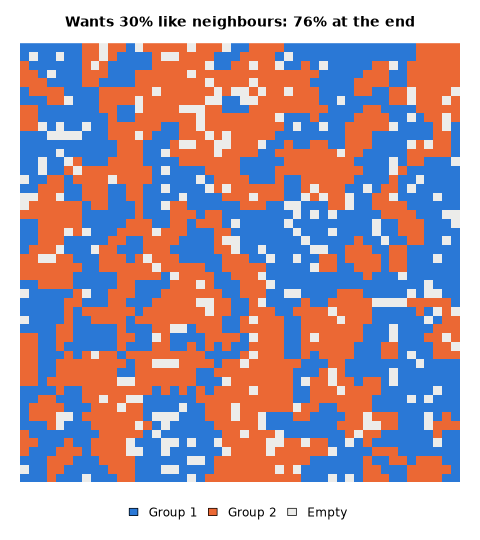
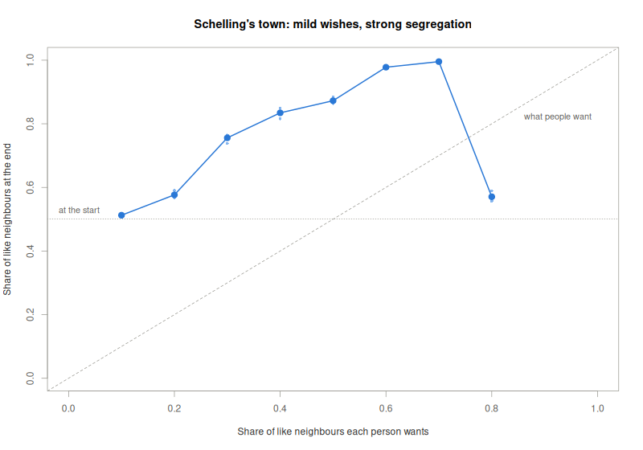

# Segregation model in R: how mild wishes divide a town

In this example you build a simulation in R from an empty folder and run
it 40 times on the cluster, with different settings and different random
numbers. The project needs nothing but R itself, so it is the simplest
kind of project for the cluster.

The simulation is Schelling's model of segregation (Schelling 1971). Two
groups of people live in a town laid out as a grid. Each person wants a
certain share of their neighbours to belong to their own group. Whoever
has fewer such neighbours than they want moves to a random empty place.
You will try eight wishes, from 10% to 80% like neighbours, each with
five different random starts. The question is how divided the town
becomes, even when people's wishes are mild.

You write the code in RStudio and test one run on your computer. Then the
cluster runs all 40, and you bring the results back to draw one figure.

The finished files are next to this page: [run.R](run.R),
[runs.txt](runs.txt), [job.slurm](job.slurm) and [combine.R](combine.R).
If something does not work, you can compare your files with them.

**Time:** 45 min

## Before you start

You need a computer that is set up for the cluster, as described in the
[setup guide](../../../docs/basics/setup.md), and sc-starter, as
[Install sc-starter](../../../docs/sc-starter/install.md) describes. When you type
`sc-starter check` in a terminal, it should print `Ready.`

You also need R and RStudio, as described in
[Topic model in R](../r-topic-model/README.md#before-you-start). This
project uses no packages, so you need no renv.

## Plan the project

One run of the project simulates the town once. Two things change from
run to run. The first is the wish, the share of like neighbours each
person wants. The second is the *seed*, the number that fixes the random
numbers of the simulation. So the script takes two *arguments*:
`Rscript run.R 0.3 2` simulates a town in which everyone wants 30%
like neighbours, with seed 2.

Several seeds are needed because each run places people at random and
moves them to random places. One run can therefore be lucky or unlucky. Five runs with
the same wish and different seeds show how much the result varies. And
with the same seed, a run gives exactly the same town again.

Each run writes its result into a file of its own, such as
`results/run-0.3-2.csv`. A last script, `combine.R`, puts the 40 results
together on your computer.

A run takes about a second. 40 runs would take less than a minute on
your own computer as well, so the cluster is not needed for this size.
It pays off when the town is larger or each wish gets hundreds of seeds,
and the steps stay the same. On the cluster, starting a run takes longer
than one of these runs. For a real study, let each run do more work, as
described at the end of this page.

The cluster provides R itself, and the project uses no packages, so
nothing has to be installed on the cluster before the runs.

When the project is finished, the folder looks like this:

```text title="r-segregation/"
r-segregation/
├── r-segregation.Rproj   RStudio's project file
├── run.R                 simulates the town once
├── runs.txt              the 40 commands for the cluster
├── job.slurm             what each run needs
├── combine.R             puts the results together
└── results/              what the runs write
```

## Part 1: Build and test the project on your computer

### 1. Create the project

Open RStudio and choose File › New Project › New Directory › New Project.
Type `r-segregation` as the name of the directory, and choose the folder
in which you keep your projects. Leave the boxes below unticked, and
click Create Project. Its folder is now the working directory of R.

**Check:** The Files pane of RStudio shows the folder `r-segregation`
with the file `r-segregation.Rproj`, which RStudio created.

### 2. Write the simulation

Choose File › New File › R Script, and save the empty file as `run.R` in
the project folder. You will add the code in eight parts. Paste each part
at the end of the file.

The first part describes the script and reads the two arguments. If one
is missing or is not a number, the script stops with a message that says
how to call it:

```r title="run.R"
# One run of Schelling's segregation model.
#
# Usage: Rscript run.R <threshold> <seed>
#   threshold: the share of like neighbours each person wants, 0 to 1
#   seed: the random number seed, so that a run can be repeated exactly
# Writes results/run-<threshold>-<seed>.csv and, for seed 1, a picture of
# the grid at the end, results/grid-<threshold>.png. Needs only base R.

# The wish and the seed, from the command line: Rscript run.R 0.3 2.
args <- commandArgs(trailingOnly = TRUE)
threshold <- as.numeric(args[1])
seed <- as.integer(args[2])
if (length(args) != 2 || is.na(threshold) || is.na(seed)) {
  stop("Usage: Rscript run.R <threshold> <seed>")
}
```

The code calls the wish `threshold`, because a person moves when their
share of like neighbours falls below it.

The second part sets the size of the town. These values stay the same in
every run, so they are written into the script instead of being
arguments:

```r title="run.R"
size <- 50 # the town is a grid of size x size places
vacant <- 0.1 # share of empty places
max_rounds <- 200 # stop here if people are still moving
```

The town has 50 × 50 places, 10% of them empty. The simulation stops
after 200 rounds at the latest, because with high wishes people may never
be content.

The third part defines three functions. Together they compute, for every
person, the share of like people among their eight neighbours:

```r title="run.R"
# Shift a matrix by dr rows and dc columns; places shifted in are 0.
shift <- function(m, dr, dc) {
  out <- matrix(0, nrow(m), ncol(m))
  rows <- max(1, 1 + dr):min(nrow(m), nrow(m) + dr)
  cols <- max(1, 1 + dc):min(ncol(m), ncol(m) + dc)
  out[rows, cols] <- m[rows - dr, cols - dc]
  out
}

# For every place, how many of its 8 neighbours belong to `group`.
neighbours <- function(grid, group) {
  member <- (grid == group) * 1
  count <- 0
  for (dr in -1:1) {
    for (dc in -1:1) {
      if (dr != 0 || dc != 0) count <- count + shift(member, dr, dc)
    }
  }
  count
}

# For every person, the share of like people among their neighbours;
# NA for empty places. Someone without neighbours counts as content.
like_share <- function(grid) {
  group_1 <- neighbours(grid, 1)
  group_2 <- neighbours(grid, 2)
  same <- ifelse(grid == 1, group_1, group_2)
  share <- ifelse(group_1 + group_2 > 0, same / (group_1 + group_2), 1)
  share[grid == 0] <- NA
  share
}
```

The town is a matrix in which 0 marks an empty place and 1 or 2 the group
of the person living there. `neighbours()` counts, for every place at
once, how many neighbours belong to a group. It does so by shifting the
whole matrix one step in each of the eight directions with `shift()` and
adding up. This is much faster in R than visiting each place in a loop.
`like_share()` then divides the like neighbours by all neighbours.

The fourth part sets the seed and fills the town at random:

```r title="run.R"
set.seed(seed)
# 0 is an empty place; 1 and 2 are the two groups, equally large, placed
# at random.
people <- round(size^2 * (1 - vacant))
places <- c(rep(1:2, length.out = people), rep(0, size^2 - people))
grid <- matrix(sample(places), size, size)
like_start <- mean(like_share(grid), na.rm = TRUE)
```

`set.seed(seed)` comes before the first random number. From here on, the
same seed gives the same town and the same moves. `sample()` shuffles the
places, so the two groups start out mixed at random, and each person has
about 50% like neighbours.

The fifth part is the simulation itself:

```r title="run.R"
# Let unhappy people move, round by round, until all are content.
rounds <- 0
repeat {
  share <- like_share(grid)
  unhappy <- which(!is.na(share) & share < threshold)
  if (length(unhappy) == 0 || rounds == max_rounds) {
    break
  }
  # Every unhappy person moves to a random empty place at once; the places
  # they leave are free in the next round.
  empty <- which(grid == 0)
  movers <- unhappy[sample.int(length(unhappy))]
  moves <- min(length(movers), length(empty))
  targets <- empty[sample.int(length(empty), moves)]
  movers <- movers[seq_along(targets)]
  grid[targets] <- grid[movers]
  grid[movers] <- 0
  rounds <- rounds + 1
}
```

In each round, the script finds everyone whose share of like neighbours is
below the wish. If there is nobody, or the town has had 200 rounds, the
loop ends. Otherwise these people move, in random order, to random empty
places.

The sixth part saves the result of the run:

```r title="run.R"
# The result of this run, as one row of results/run-<threshold>-<seed>.csv.
result <- data.frame(
  threshold = threshold,
  seed = seed,
  rounds = rounds,
  settled = length(unhappy) == 0,
  like_start = round(like_start, 3),
  like_end = round(mean(share, na.rm = TRUE), 3),
  # So that combine.R can tell results of an earlier job apart.
  job = Sys.getenv("SLURM_ARRAY_JOB_ID")
)
dir.create("results", showWarnings = FALSE)
write.csv(
  result,
  sprintf("results/run-%s-%d.csv", format(threshold), seed),
  row.names = FALSE
)
```

The result is one row. It holds the wish and the seed, and how many
rounds the town needed. It also says whether everyone was content at the
end, and gives the share of like neighbours at the start and at the end.

On the cluster, Slurm gives each job a number, the *job ID*. It puts this
number into the variable `SLURM_ARRAY_JOB_ID`, so the column
`job` shows which job a result came from. On your computer it stays
empty.

The result goes into a file named after the wish and the seed. The 40
runs end at about the same time, so each needs a file of its own.

The seventh part draws the town at the end, but only in the runs with
seed 1, so that there is one picture per wish:

```r title="run.R"
if (seed == 1) {
  # type = "cairo": R on the cluster has no screen, and its default way of
  # drawing PNG files needs one.
  png(
    sprintf("results/grid-%s.png", format(threshold)),
    width = 480,
    height = 540,
    type = "cairo"
  )
  par(mar = c(4, 1, 3, 1))
  # Blue and orange pass the colour-blindness checks; empty places are light.
  image(
    grid,
    col = c("#ececea", "#2a78d6", "#eb6834"),
    breaks = c(-0.5, 0.5, 1.5, 2.5),
    axes = FALSE,
    asp = 1,
    main = sprintf(
      "Wants %d%% like neighbours: %d%% at the end",
      round(100 * threshold),
      round(100 * result$like_end)
    )
  )
  legend(
    "bottom",
    legend = c("Group 1", "Group 2", "Empty"),
    fill = c("#2a78d6", "#eb6834", "#ececea"),
    horiz = TRUE,
    bty = "n",
    inset = c(0, -0.1),
    xpd = TRUE
  )
  invisible(dev.off())
}
```

The line `type = "cairo"` in `png()` matters. The computers of the
cluster have no screen, and R's usual way of drawing PNG files needs one. Without this
line, the picture fails on the cluster, although it works on your
computer. The result of the run is saved before the picture, so that a
failing picture loses no numbers.

The last part prints one line about the run:

```r title="run.R"
# One line for the output file of the run.
cat(sprintf(
  "Threshold %s, seed %d: %d rounds, like neighbours %.0f%% -> %.0f%%\n",
  format(threshold),
  seed,
  rounds,
  100 * result$like_start,
  100 * result$like_end
))
```

**Check:** Save the file and type `source("run.R")` in the Console. R
stops with `Usage: Rscript run.R <threshold> <seed>`, because `source()`
passes no arguments. This shows that the file is saved. The real test
follows in step 3.

### 3. Test one run on your computer

Run the script once, with a wish of 30% and seed 1. On Linux and macOS,
click the Terminal tab next to the Console in RStudio, and type:

```bash title="Your computer"
Rscript run.R 0.3 1
```

On Windows, the terminal does not find `Rscript`, because the R installer
does not tell it where R is. Type this line in the Console of RStudio
instead:

```r title="R"
system2(file.path(R.home("bin"), "Rscript"), c("run.R", "0.3", "1"))
```

The run takes about a second and prints:

```text title="Output"
Threshold 0.3, seed 1: 13 rounds, like neighbours 50% -> 76%
```

**Check:** The folder `results` now holds two files. `run-0.3-1.csv`
holds the result:

```text title="results/run-0.3-1.csv"
"threshold","seed","rounds","settled","like_start","like_end","job"
0.3,1,13,TRUE,0.5,0.756,""
```

The numbers should be exactly these, because the seed fixes the random
numbers. The second file, `grid-0.3.png`, shows the town at the end:



People wanted only 30% like neighbours, but at the end they have 76%, and
the town consists of blue and orange quarters.

<details class="fix" markdown>
<summary>If it did not work</summary>

If you see `Usage: Rscript run.R <threshold> <seed>`, one of the two
numbers after `run.R` is missing.

If your numbers differ, compare your `run.R` with the
[finished file](run.R). A changed line before or in the loop changes the
random numbers that follow.

</details>

### 4. Measure what a run needs

Measure the run that takes longest. With a high wish, people keep moving
for all 200 rounds, so try a wish of 80% with seed 1: `Rscript run.R 0.8 1`
in the terminal, or on Windows in the Console:

```r title="R"
system2(file.path(R.home("bin"), "Rscript"), c("run.R", "0.8", "1"))
```

A run this short ends before you can watch its memory in the task
manager. Each run takes about a second and uses under 150 MB of memory.
Take these values.

**Check:** The run prints a line that ends with `200 rounds` and a share
of like neighbours, and it took a second or two.

## Part 2: Prepare the project for the cluster

### 5. List the runs

The cluster needs 40 lines in `runs.txt`: eight wishes, each with seeds 1
to 5. Instead of typing them, let R write the file. Type this in the
Console:

```r title="R"
writeLines(sprintf("Rscript run.R %.1f %d", rep(seq(0.1, 0.8, 0.1), each = 5), 1:5), "runs.txt")
```

`seq(0.1, 0.8, 0.1)` makes the eight wishes, and `rep(..., each = 5)`
repeats each of them five times. `1:5` adds the seeds, which R repeats
for every wish. `sprintf()` puts each pair into a command, and
`writeLines()` writes one command per line.

**Check:** Count the lines of the new file and show the first three:

```r title="R"
length(readLines("runs.txt"))
head(readLines("runs.txt"), 3)
```

```text title="Output"
[1] 40
[1] "Rscript run.R 0.1 1" "Rscript run.R 0.1 2" "Rscript run.R 0.1 3"
```

Each line is one run, and the line number is the run number. Line 40
reads `Rscript run.R 0.8 5`.

### 6. Write the job script

A *job script* tells Slurm what each run needs and what it should do.
Create a file called `job.slurm`, with File › New File › Text File:

```bash title="job.slurm"
#!/bin/bash
# One run per line of runs.txt; run N is line N, here one threshold and one
# random number seed. Submit from your computer with `sc-starter submit`.
# This project needs only base R, so there is no setup.slurm.

#SBATCH --job-name=r-segregation  # name in the queue and in the output files
#SBATCH --partition=cpu-xeonv3    # standard CPU partition; sinfo -s lists them all
#SBATCH --cpus-per-task=1         # the model uses one core
#SBATCH --mem=1G                  # 1 GB of memory per run
#SBATCH --time=00:05:00           # Slurm stops a run after 5 minutes
#SBATCH --output=%x-%A_%a.out     # job name, job ID, run number
#SBATCH --mail-type=END,FAIL      # email when the whole array has ended or failed

module load R/4.5.2-gfbf-2025b
# As in the SC documentation; avoids locale warnings from R.
export LC_ALL=C.UTF-8

# This run's line of runs.txt, for example "Rscript run.R 0.3 2".
run=$(sed -n "${SLURM_ARRAY_TASK_ID}p" runs.txt)
# No such line, as when runs.txt got shorter: end the run as FAILED.
[ -n "$run" ] || { echo "runs.txt has no line $SLURM_ARRAY_TASK_ID"; exit 1; }
echo "Run $SLURM_ARRAY_TASK_ID on $(hostname -s): $run"
bash -c "$run"
```

The lines that begin with `#SBATCH` are requests to Slurm. The values
come from your measurement in step 4: one core, 1 GB of memory for a run
that used under 150 MB, and 5 minutes for a run of a second. Both are
more than a run needs.

Below the `#SBATCH` lines are the commands that each run carries out.
`module load R/4.5.2-gfbf-2025b` switches on R. The script uses only what comes with R, so the version of
R matters little here. The other lines pick this run's line out of
`runs.txt` and run it. They work as in the job script of
[Topic model in R](../r-topic-model/README.md#10-write-the-job-script),
and [Your first job](../../../docs/slurm/first-job.md) explains every line.

**Check:** The Files pane shows the file `job.slurm`, not
`job.slurm.txt`.

## Part 3: Run the project on the cluster

You type all commands in this part in a terminal on your computer, in the
project folder. The Terminal tab of RStudio opens there.

On Windows, set the Terminal tab of RStudio to PowerShell first, as
described in
[Topic model in R](../r-topic-model/README.md#part-3-run-the-project-on-the-cluster).

### 7. Start the 40 runs

Before you start, check that your computer still reaches the cluster:

```bash title="Your computer"
sc-starter check
```

It prints `Ready.` If not, it says what is missing, such as the VPN.

Then start the runs:

```bash title="Your computer"
sc-starter submit
```

```text title="Output"
Submitted job 28514655 with runs 1-40. See how it goes with `sc-starter status`.
```

Before this line, sc-starter prints how many files it uploaded. It copied
your project to the cluster, into `sc-projects/r-segregation` in your home
directory there, and asked Slurm for 40 runs, one for each line of
`runs.txt`. Your job ID will be different.

Follow the runs with `sc-starter status`. It shows one line per run. The
runs are short, so after a minute or two all of them are `COMPLETED`. To
see what a single run printed, add its number. Run 11 is line 11 of
`runs.txt`, the wish of 30% with seed 1:

```bash title="Your computer"
sc-starter log 11
```

```text title="Output"
Run 11 on t004: Rscript run.R 0.3 1
Threshold 0.3, seed 1: 13 rounds, like neighbours 50% -> 76%
```

The cluster got exactly the same result as your computer, because the
seed is the same.

**Check:** `sc-starter status` shows all 40 runs as `COMPLETED`.

<details class="fix" markdown>
<summary>If it did not work</summary>

If runs are `FAILED`, `sc-starter log` with the number of a run shows the
error message. Without `type = "cairo"` in `png()`, the runs with seed 1
fail like this:

```text title="Output"
Error in .External2(C_X11, paste0("png::", filename), g$width, g$height,  :
  unable to start device PNG
```

Fix the problem on your computer and test the run there. Then submit only
the failed runs again with `sc-starter submit --lines failed.txt`.
`sc-starter status` has written their numbers into `failed.txt`.
[Troubleshooting](../../../docs/reference/troubleshooting.md) explains more error
messages.

</details>

### 8. Bring the results back

```bash title="Your computer"
sc-starter pull
```

sc-starter copies the `results` folder from the cluster into your project
folder, together with the 40 output files of the runs, such as
`r-segregation-28514655_11.out`.

**Check:** The folder `results` holds 40 result files, from
`run-0.1-1.csv` to `run-0.8-5.csv`, and eight pictures, from
`grid-0.1.png` to `grid-0.8.png`.

## Part 4: Put the results together

### 9. Write the summary script

The last script runs on your computer. It reads the 40 result files,
takes the mean over the five seeds of each wish, prints a table and draws
a figure. Create a new R script, save it as `combine.R`, and add the code
in five parts.

The first part reads all result files into one table:

```r title="combine.R"
# On your computer, after `sc-starter pull`: put all runs side by side.
#
# Usage: Rscript combine.R
# Reads results/run-*.csv, names missing runs, prints one line per
# threshold and draws results/segregation.png. Needs only base R.

# Every result file that the runs wrote, read into one table.
files <- list.files("results", pattern = "^run-.*\\.csv$", full.names = TRUE)
if (length(files) == 0) {
  stop("No results yet. Run `sc-starter pull` first.")
}
runs <- do.call(rbind, lapply(files, read.csv))
```

The second part compares the results with `runs.txt`. sc-starter never
deletes anything on the cluster. If you once tried other wishes or seeds,
their results are still in `results`, and they would change the means. So
the script leaves them out:

```r title="combine.R"
# runs.txt lines read "Rscript run.R 0.3 2": threshold, then seed.
# Compared as numbers, so that 0.35 and 0.3 stay apart and 0.30 is 0.3.
# warn = FALSE: an editor may save runs.txt without a line break at the end.
planned <- sub("^Rscript run.R ", "", readLines("runs.txt", warn = FALSE))
wanted <- read.table(text = planned, col.names = c("threshold", "seed"))
wanted <- paste(wanted$threshold, wanted$seed)
done <- paste(runs$threshold, runs$seed)

# Nothing on the cluster is deleted, so results/ may still hold runs that
# an earlier runs.txt asked for; they would change the means.
old <- !done %in% wanted
if (any(old)) {
  message(
    "Left out results of runs not in runs.txt: ",
    toString(done[old]),
    "."
  )
  runs <- runs[!old, ]
}
if (nrow(runs) == 0) {
  stop("No results for the runs in runs.txt yet. Run `sc-starter pull` first.")
}
```

The third part says which job the results come from, and names the runs
that have no result yet:

```r title="combine.R"
# A run that fails in a later job leaves its earlier result in place.
jobs <- table(runs$job)
cat(
  "Runs per job: ",
  paste(jobs, "from job", names(jobs), collapse = ", "),
  "\n",
  sep = ""
)

missing <- planned[!wanted %in% done]
if (length(missing) > 0) {
  message(
    "No results for threshold and seed: ",
    toString(missing),
    ". `sc-starter status` shows why."
  )
}
```

The fourth part takes the mean over the seeds of each wish and prints
one line per wish. `share_settled` is the share of the five runs in which
everyone was content at the end:

```r title="combine.R"
# One line per threshold: mean over the seeds.
summary <- aggregate(
  cbind(like_start, like_end, rounds, settled) ~ threshold,
  data = runs,
  FUN = mean
)
names(summary)[names(summary) == "settled"] <- "share_settled"
print(round(summary, 2), row.names = FALSE)
```

The last part draws the share of like neighbours at the end against the
wish. Each run is a small point, and the mean over its seeds is a large
one. Two thin lines mark what people asked for and where the town
started:

```r title="combine.R"
# The figure: the share of like neighbours at the end against the wish.
png("results/segregation.png", width = 800, height = 560)
par(col.axis = "#5f5e5a", col.lab = "#2b2b29", fg = "#9a9992")
plot(
  summary$threshold,
  summary$like_end,
  type = "n",
  xlim = c(0, 1),
  ylim = c(0, 1),
  xlab = "Share of like neighbours each person wants",
  ylab = "Share of like neighbours at the end",
  main = "Schelling's town: mild wishes, strong segregation"
)
# What people ask for, and where the town starts.
abline(0, 1, lty = 2, col = "#9a9992")
start <- mean(runs$like_start)
abline(h = start, lty = 3, col = "#9a9992")
text(0.85, 0.82, "what people want", col = "#5f5e5a", pos = 4, cex = 0.9)
text(0.02, start, "at the start", col = "#5f5e5a", pos = 3, cex = 0.9)
# Each seed as a small point, the mean over seeds as the line.
points(runs$threshold, runs$like_end, pch = 16, cex = 0.7, col = "#86b6ef")
lines(summary$threshold, summary$like_end, lwd = 2, col = "#2a78d6")
points(
  summary$threshold,
  summary$like_end,
  pch = 19,
  cex = 1.4,
  col = "#2a78d6"
)
invisible(dev.off())
cat("Wrote results/segregation.png\n")
```

This script runs on your computer, which has a screen, so `png()` needs
no `type = "cairo"` here.

### 10. Run the summary script

Save the file and click Source at the top right of the editor. The
script needs no argument, so `source()`, which the button runs, works on
every system.

**Check:** The script prints this table:

```text title="Output"
Runs per job: 40 from job 28514655
 threshold like_start like_end rounds share_settled
       0.1        0.5     0.51    1.8           1.0
       0.2        0.5     0.58    6.8           1.0
       0.3        0.5     0.76   14.0           1.0
       0.4        0.5     0.83   17.4           1.0
       0.5        0.5     0.87   21.8           1.0
       0.6        0.5     0.98   86.2           1.0
       0.7        0.5     1.00  163.4           0.8
       0.8        0.5     0.57  200.0           0.0
Wrote results/segregation.png
```

The numbers should be exactly these.



## Reading the results

At the start, people have about 50% like neighbours, because the town is
mixed at random. People who want 30% like neighbours end up with 76%. At
a wish of 60%, the town splits almost completely. Small wishes add up to
far more segregation than anyone asked for, which is Schelling's point.

Very high wishes are different. At 80%, no run settles within 200
rounds: almost nobody finds a place that pleases them, people keep moving,
and the town stays nearly as mixed as at the start. The column
`share_settled` shows this, and so does `grid-0.8.png`.

## Using the project further

To try other wishes or more seeds, write `runs.txt` again with other
values. For ten seeds per wish:

```r title="R"
writeLines(sprintf("Rscript run.R %.1f %d", rep(seq(0.1, 0.8, 0.1), each = 10), 1:10), "runs.txt")
```

Then run `sc-starter submit` again. First wait until `sc-starter status`
shows no `PENDING` run of the previous job, because a waiting run reads
`runs.txt` only when it starts.

For a larger town or more rounds, change `size` or `max_rounds` in the
second part of `run.R`, test one run on your computer, and measure it
again. A run that takes longer needs a longer `--time` in `job.slurm`.

For a real study, give each run more work, so that it takes minutes
instead of a second. For example, let `run.R` loop over 100 seeds and
write one file with 100 rows. Slurm then starts fewer runs, each of which
does more.

[Bring your own project](../../../docs/sc-starter/bring-your-own-project.md) goes through
these points for a project of your own.

## Removing the project from the cluster

When you no longer need the project on the cluster, delete its folder
there:

```bash title="Your computer"
ssh sc-export rm -rI sc-projects/r-segregation
```

`rm -rI` asks once before it deletes. Type `y` and press Enter.

## Sources

- Schelling, T. C. (1971). Dynamic models of segregation. *Journal of
  Mathematical Sociology*, 1(2), 143–186.
  <https://doi.org/10.1080/0022250X.1971.9989794>
