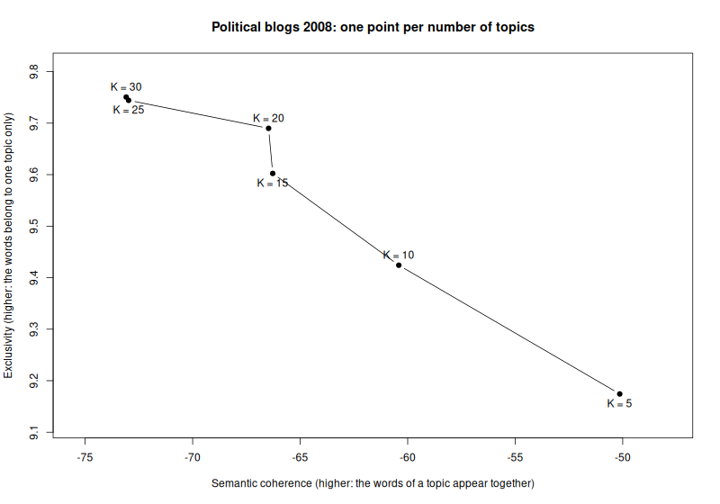

# Topic model in R: finding the number of topics in political blogs

In this example you build a small research project in R from an empty
folder and run it on the cluster. It is the R version of
[Topic model in Python](../../python/python-topic-model/README.md): the
same blogs and the same question, with the R package stm.

The project fits a topic model to 5,000 posts from six US political blogs
of 2008. A topic model finds groups of words that often appear together
in a collection of texts. Each group is a topic. You decide how many
topics the model looks for, and a common way to decide is to fit the
model several times and compare the fits. You will fit it six times,
with 5, 10, 15, 20, 25 and 30 topics.

You write the code in RStudio and test it on your computer. Then the
cluster runs all six fits at the same time, and you bring the results
back to your computer to compare them.

The finished files are next to this page: [run.R](run.R),
[runs.txt](runs.txt), [job.slurm](job.slurm), [setup.slurm](setup.slurm),
[combine.R](combine.R), `.Rprofile` and
[renv.lock](renv.lock). If something does not work, you can compare your
files with them.

**Time:** 60 min

## Before you start

You need a computer that is set up for the cluster, as described in the
[setup guide](../../../docs/basics/setup.md), and sc-starter, as
[Install sc-starter](../../../docs/sc-starter/install.md) describes. When you type
`sc-starter check` in a terminal, it should print `Ready.`

You also need R, version 4.5 or newer, and RStudio. Install R from [CRAN](https://cran.r-project.org/)
and RStudio from [Posit](https://posit.co/download/rstudio-desktop/).

## Plan the project

Before you write code, decide what one run of the project is. Here, one
run fits the model once, with one number of topics. The number of topics
is the only thing that changes from run to run. So the script takes it as
an *argument*: `Rscript run.R 10` fits a model with 10 topics.

Each run writes its results into two files of its own, with the number of
topics in the name, such as `results/k-10.csv`. Six runs that end at the
same time would otherwise overwrite each other's results. A last script,
`combine.R`, puts the six results side by side on your computer.

The fit with 5 topics takes about a minute and a half, and the fit with
30 topics almost four minutes. All
six one after another would take about a quarter of an hour. That still
fits on your own computer, but a real analysis would let each model run
until it settles, and would try more numbers of topics. Then the runs take
hours. On the cluster, the runs run side by side, so all six take no
longer than the longest one.

The cluster needs the same R packages as your computer, in the same
versions. The R package renv takes care of this.
[Packages: uv and renv](../../../docs/project/packages.md) explains how.

When the project is finished, the folder looks like this:

```text title="r-topic-model/"
r-topic-model/
├── r-topic-model.Rproj   RStudio's project file
├── run.R                 fits one model
├── runs.txt              the six commands for the cluster
├── job.slurm             what each run needs
├── setup.slurm           installs the packages on the cluster
├── combine.R             compares the six fits
├── renv.lock             the project's packages and their exact versions
├── .Rprofile             switches the project's packages on
├── renv/                 renv's own files
└── results/              what the runs write
```

## Part 1: Build and test the project on your computer

### 1. Create the project

Open RStudio and choose File › New Project › New Directory › New Project.
Type `r-topic-model` as the name of the directory, and choose the folder
in which you keep your projects. Leave the boxes below unticked, and
click Create Project. RStudio opens the new, empty project. Its folder is
now the working directory of R, so everything you do in the Console
happens in this folder. RStudio also creates the file
`r-topic-model.Rproj` and a hidden folder `.Rproj.user` for its own
settings.

Now set up renv. Type these two lines in the Console, one after the
other:

```r title="R"
install.packages("renv")
renv::init()
```

The first line installs renv. If R asks whether to use a personal
library, answer yes. The second line sets up the project. The first time
you use renv, it explains what it does and asks
`Do you want to proceed? [Y/n]`. Press Enter to answer yes.

renv writes `renv.lock`, the *lock file* that will list every package
with its exact version, a folder `renv`, and a file `.Rprofile`. R runs
`.Rprofile` whenever it starts in this folder, and renv's line in it
switches the project's own packages on. RStudio then restarts R.

**Check:** After the restart, the Console shows a line such as
`- Project '~/r-topic-model' loaded. [renv 1.3.1]`, and the Files pane
lists `renv.lock` and the folder `renv`.

### 2. Choose the package server

R downloads packages from a server. Unless you choose another one, this
is CRAN. For Linux, which the cluster
runs, CRAN offers only the source code of the packages, and the cluster
would have to compile each one. That takes several minutes. The Posit
Package Manager offers the same packages ready-made for Linux, Windows and
macOS.

Open `.Rprofile` from the Files pane. It is a hidden file, so if you do
not see it, choose More › Show Hidden Files in that pane. Add a second
line, so that the file reads:

```r title=".Rprofile"
source("renv/activate.R")
options(repos = c(CRAN = "https://p3m.dev/cran/latest"))
```

Save the file and restart R with Session › Restart R. From now on, R in
this project takes its packages from the Posit Package Manager, and renv
writes this server into `renv.lock`, so that the cluster uses it too.

**Check:** In the Console, type `getOption("repos")`. It shows
`https://p3m.dev/cran/latest`.

### 3. Install the topic model package

The model in this project comes from the package stm, the structural
topic model (Roberts et al. 2019). Install it in the Console:

```r title="R"
install.packages("stm")
```

renv lists stm and the 28 packages that stm needs, and asks
`Do you want to proceed? [Y/n]`. Press Enter. renv then installs them into
the project. On Windows, macOS and common Linux systems, this takes under
a minute, because the packages come ready-made. It ends with a line such
as:

```text title="Output"
Successfully installed 29 packages in 18 seconds.
```

**Check:** `packageVersion("stm")` prints the version of stm, for example
`[1] ‘1.3.8’`.

### 4. Look at the data

The data set comes with stm. It is called poliblog5k and holds 5,000 blog
posts from the time of the 2008 US presidential election, taken from three
liberal and three conservative blogs. It is a sample of the CMU 2008
Political Blog Corpus (Eisenstein and Xing 2010).

The posts are already prepared for a topic model. Very common words such
as "the" have been removed, and each word has been cut down to its stem,
so `econom` stands for economy, economic and economics.

**Check:** Load the data in the Console and look at it:

```r title="R"
data(poliblog5k, package = "stm")
length(poliblog5k.docs)
length(poliblog5k.voc)
head(poliblog5k.meta, 3)
```

```text title="Output"
[1] 5000
[1] 2632
           rating day blog                                              text
6787 Conservative 182   ha How happy do you think Team Barry is that, thanks
8150 Conservative 299   ha  Tough stuff, but conservative passions this year
4961      Liberal 345   db Epic Ideological Failby digbyBefore you listen to
```

The data come in three parts. `poliblog5k.docs` holds the 5,000 posts as
lists of word counts, and `poliblog5k.voc` the 2,632 different word stems.
`poliblog5k.meta` holds the *metadata*, information about each post. The
column `rating` gives the leaning of its blog, `day` the day of the year,
`blog` the blog, and `text` the beginning of the post.

### 5. Write the model script

Choose File › New File › R Script, and save the empty file as `run.R` in
the project folder. You will add the code in six parts. Paste each part
at the end of the file.

The first part describes the script in a few comments and loads stm:

```r title="run.R"
# One run of the topic model: fit stm with K topics on the political blogs.
#
# Usage: Rscript run.R <K>
# Writes results/k-<K>.csv with two quality measures and
# results/k-<K>-topics.txt with the most telling words of each topic.

library(stm)
```

The second part reads the argument, the number of topics, and calls it
`k`. `commandArgs(trailingOnly = TRUE)` returns the values written after
the name of the script. If there is none, or it is not a number, the
script stops with a message that says how to call it:

```r title="run.R"
# The number of topics, from the command line: Rscript run.R 10 gives 10.
k <- as.integer(commandArgs(trailingOnly = TRUE)[1])
if (is.na(k)) {
  stop("Usage: Rscript run.R <number of topics>")
}
```

The third part loads the data, as you did in the Console:

```r title="run.R"
# 5,000 posts from six US political blogs in 2008, shipped with stm and
# already prepared as documents and vocabulary; `rating` says whether a blog
# is liberal or conservative.
data(poliblog5k, package = "stm")
```

The fourth part fits the model and measures how long the fit takes:

```r title="run.R"
started <- Sys.time()
# Spectral initialisation gives the same result on the same machine, so the
# runs differ only in K. At most 75 rounds, as in the stm vignette, so that
# each run takes minutes; a real analysis would let it converge.
model <- stm(
  poliblog5k.docs,
  poliblog5k.voc,
  K = k,
  prevalence = ~rating,
  data = poliblog5k.meta,
  init.type = "Spectral",
  max.em.its = 75,
  verbose = FALSE
)
minutes <- as.numeric(difftime(Sys.time(), started, units = "mins"))
```

`stm()` takes the posts, the word stems and the number of topics.
`prevalence = ~rating` lets the share of each topic depend on the leaning
of the blog, which is what makes this a structural topic model.
`init.type = "Spectral"` chooses the starting point of the fit by a fixed
calculation instead of by chance. The same number of topics therefore
gives the same model on every run. The script needs no *seed*, the number
that would otherwise fix the random numbers of the fit.

The model improves its fit in rounds. `max.em.its = 75` stops it after at
most 75 rounds, as the stm vignette does in its examples, so that each
run takes minutes. A real analysis would leave this out and let the
model run until it settles.

The fifth part computes two measures of quality and saves them:

```r title="run.R"
# The two measures and the time, as one row of results/k-<K>.csv.
dir.create("results", showWarnings = FALSE)
quality <- data.frame(
  k = k,
  coherence = mean(semanticCoherence(model, poliblog5k.docs)),
  exclusivity = mean(exclusivity(model)),
  minutes = round(minutes, 2),
  # So that combine.R can tell results of an earlier job apart.
  job = Sys.getenv("SLURM_ARRAY_JOB_ID")
)
write.csv(quality, sprintf("results/k-%02d.csv", k), row.names = FALSE)
```

*Semantic coherence* asks whether the top words of a topic appear in the
same posts (Mimno et al. 2011). *Exclusivity* asks whether they belong to
this topic and to no other. Higher is better for both, and with more
topics, coherence usually falls while exclusivity rises. The script takes
the mean over all topics.

The results go into the folder `results`, into a file named after the
number of topics. `%02d` writes the number with two digits, `k-05.csv`
instead of `k-5.csv`, so that the files sort in the right order.

On the cluster, Slurm gives each job a number, the *job ID*. It puts this
number into the variable `SLURM_ARRAY_JOB_ID`. The column `job`
therefore shows which job a result came from. On your computer it stays
empty.

The last part saves the words that describe each topic best, and prints
a short message:

```r title="run.R"
# FREX words: frequent in the topic and rare in the others.
words <- labelTopics(model, n = 7)$frex
topics <- sprintf(
  "Topic %2d: %s",
  seq_len(k),
  apply(words, 1, paste, collapse = ", ")
)
writeLines(topics, sprintf("results/k-%02d-topics.txt", k))
cat(sprintf("K = %d done in %.1f minutes\n", k, minutes))
```

`labelTopics()` lists words for each topic in several ways. The FREX
words are frequent in the topic and rare in the others, which makes the
topics easy to tell apart.

**Check:** Save the file and type `source("run.R")` in the Console. R
loads stm and then stops with
`Usage: Rscript run.R <number of topics>`, because `source()` passes no
number of topics. This shows that the file is saved and that stm loads.
The real test follows in step 7.

### 6. Record the packages

`run.R` now loads stm, so renv knows that the project needs it. Write the
packages into the lock file:

```r title="R"
renv::snapshot()
```

renv lists the packages with their versions, such as `stm [* -> 1.3.8]`,
and asks `Do you want to proceed? [Y/n]`. Press Enter. It ends with
`Lockfile written`. `renv::snapshot()` records the packages that a script
of the project loads, and the packages these need.

**Check:** `renv::status()` prints
`No issues found -- the project is in a consistent state.`

### 7. Test one fit on your computer

Run the script once with 5 topics. Mistakes show up here within minutes.
On the cluster, you would see them only after your job has waited for its
turn.

In RStudio, click the Terminal tab next to the Console. The terminal opens
in the project folder. On Linux and macOS, type:

```bash title="Your computer"
Rscript run.R 5
```

On Windows, the terminal does not find `Rscript`, because the R installer
does not tell it where R is. Type this line in the Console instead. It
starts the same command with the `Rscript` of the R that RStudio uses:

```r title="R"
system2(file.path(R.home("bin"), "Rscript"), c("run.R", "5"))
```

The fit takes about a minute and a half. Then the script prints:

```text title="Output"
stm v1.3.8 successfully loaded. See ?stm for help.
 Papers, resources, and other materials at structuraltopicmodel.com
K = 5 done in 1.4 minutes
```

**Check:** The folder `results` now contains two files. `results/k-05.csv`
holds the two measures:

```text title="results/k-05.csv"
"k","coherence","exclusivity","minutes","job"
5,-50.138153493238,9.1743800293325,1.45,""
```

The number of minutes on your computer will differ. Coherence should be
about −50.14 and exclusivity about 9.17. Other versions of the packages
can change the later decimal places. The
second file, `results/k-05-topics.txt`, lists the five topics with their
most telling words.

<details class="fix" markdown>
<summary>If it did not work</summary>

If you see `there is no package called 'stm'`, the package is missing
from the project. Check that RStudio has the project `r-topic-model` open,
shown at the top right, and repeat step 3.

If you see `Usage: Rscript run.R <number of topics>`, the number after
`run.R` is missing.

</details>

### 8. Measure what a run needs

The cluster needs to know how much time and memory a run takes. Measure
the largest run, the one with 30 topics, because it takes longest. Start
it as in step 7, with `30` instead of `5`. At the end, the script prints
how many minutes the fit took.

While it runs, open the task manager of your computer. It is called
Activity Monitor on macOS, Task Manager on Windows and System Monitor on
Linux. Find the process Rscript or R, and note the highest memory value
you see.

The fit with 30 topics takes about 3.6 minutes and uses about 750 MB of
memory.

**Check:** You know how many minutes the run with 30 topics took on your
computer and roughly how much memory it used.

## Part 2: Prepare the project for the cluster

### 9. List the runs

Create a file called `runs.txt`, with File › New File › Text File, and
write the six commands into it, one per line:

```text title="runs.txt"
Rscript run.R 5
Rscript run.R 10
Rscript run.R 15
Rscript run.R 20
Rscript run.R 25
Rscript run.R 30
```

Each line is one run, and the line number is the run number. Line 3, for
example, is run 3. Do not add empty lines or comments, so that the line
numbers stay the same as the run numbers.

**Check:** The editor shows six lines, numbered 1 to 6, and nothing
below line 6.

### 10. Write the job script

A *job script* tells Slurm what each run needs and what it should do.
Create a file called `job.slurm`:

```bash title="job.slurm"
#!/bin/bash
# One run per line of runs.txt; run N is line N, here one number of topics.
# Submit from your computer with `sc-starter submit`, after running
# `sc-starter submit setup.slurm` once.

#SBATCH --job-name=r-topic-model  # name in the queue and in the output files
#SBATCH --partition=cpu-xeonv3    # standard CPU partition; sinfo -s lists them all
#SBATCH --cpus-per-task=1         # stm uses one core
#SBATCH --mem=2G                  # 2 GB of memory per run
#SBATCH --time=00:10:00           # Slurm stops a run after 10 minutes
#SBATCH --output=%x-%A_%a.out     # job name, job ID, run number
#SBATCH --mail-type=END,FAIL      # email when the whole array has ended or failed

# The same R that setup.slurm installed the packages for.
module load R/4.5.2-gfbf-2025b
# As in the SC documentation; avoids locale warnings from R.
export LC_ALL=C.UTF-8

# This run's line of runs.txt, for example "Rscript run.R 10". Rscript
# without --vanilla, so that it reads .Rprofile and uses the project's
# packages from renv/library.
run=$(sed -n "${SLURM_ARRAY_TASK_ID}p" runs.txt)
# No such line, as when runs.txt got shorter: end the run as FAILED.
[ -n "$run" ] || { echo "runs.txt has no line $SLURM_ARRAY_TASK_ID"; exit 1; }
echo "Run $SLURM_ARRAY_TASK_ID on $(hostname -s): $run"
bash -c "$run"
```

The lines that begin with `#SBATCH` are requests to Slurm. The values
come from your measurement in step 8:

- One core, because stm uses one.
- 2 GB of memory, a little more than twice the 750 MB that the largest
  run used.
- 10 minutes, because the largest run took 3.6 minutes. That leaves room
  for a computer of the cluster that is slower than yours.

The runs go to `cpu-xeonv3`, the standard partition for jobs without a
GPU. Slurm saves everything a run prints in an
*output file*, whose name is made of the job name, the job ID and the run
number. When all runs have finished, Slurm sends you an email.

The first line, `#!/bin/bash`, says that the file is a script for
*bash*, the program that runs commands on the cluster. All lines that
begin with `#` and not with `#SBATCH` are comments. Below the `#SBATCH` lines are the commands that each
run carries out:

1. `module load R/4.5.2-gfbf-2025b` switches on R 4.5.2. It may be older than the R on your
   computer. That is fine, because renv installs the same versions of the
   packages for it.
2. `export LC_ALL=C.UTF-8` sets the language settings, so that R prints
   no warnings about them.
3. The line with `sed` picks this run's line out of `runs.txt`. Slurm
   gives each run its number in a variable called `SLURM_ARRAY_TASK_ID`,
   so run 3 reads line 3, `Rscript run.R 15`.
4. The next line stops the run with an error if `runs.txt` has no such
   line.
5. `echo` prints the run number, the name of the node and the
   command, so that you can see them in the output file.
6. `bash -c "$run"` runs the command. `Rscript` starts R in the project
   folder, where `.Rprofile` switches the project's packages on.

[Your first job](../../../docs/slurm/first-job.md) explains every line of a
job script in more detail.

### 11. Write the setup script

The cluster needs the same packages as your computer. A short job installs
them once, before the six runs. Create a file called `setup.slurm`:

```bash title="setup.slurm"
#!/bin/bash
# Install the R packages of this project on the cluster, once.
# Submit from your computer with `sc-starter submit setup.slurm`, before the
# first `sc-starter submit`. Compute nodes have internet; the login node is
# not for installing.

#SBATCH --job-name=r-topic-model-setup  # name in the queue and in the output file
#SBATCH --partition=cpu-xeonv3          # standard CPU partition
#SBATCH --cpus-per-task=2               # two cores, in case a package must be compiled
#SBATCH --mem=4G                        # 4 GB of memory
#SBATCH --time=00:30:00                 # usually a few minutes; more when compiling
#SBATCH --output=%x-%j.out              # job name and job ID

# Stop at the first command that fails, so that the job ends as FAILED
# rather than COMPLETED. It comes after the #SBATCH lines, since Slurm
# reads those only up to the first command.
set -e

# The R version the jobs will use.
module load R/4.5.2-gfbf-2025b
export LC_ALL=C.UTF-8
# Compile with both booked cores if a package comes as source code.
export MAKEFLAGS="-j${SLURM_CPUS_PER_TASK}"

# Starting R here runs .Rprofile, which fetches renv itself the first time.
# restore() then installs exactly the versions in renv.lock into
# renv/library, as ready-made packages for this Linux where available.
Rscript -e 'renv::restore(prompt = FALSE)'
```

This job runs on one of the cluster's compute nodes. It loads the same R module as `job.slurm`, because
packages installed for one version of R do not belong to another.
`renv::restore()` then installs exactly the package versions from
`renv.lock`. You could type these commands on the cluster yourself. But
you would type them on the login node, which everyone shares and which
is not meant for installing or computing.

The job books two cores and half an hour, in case a package is not
available ready-made and has to be compiled. This job has no list of
runs, so it runs once.

## Part 3: Run the project on the cluster

You type all commands in this part in a terminal on your computer, in the
project folder. The Terminal tab of RStudio opens there.

On Windows, the Terminal tab of RStudio opens Git Bash if Git for Windows
is installed. There, sc-starter would use the SSH of Git, which cannot
use your key. Choose Tools › Global
Options › Terminal, set New terminals open with to Windows PowerShell, and
open a new terminal. Or use PowerShell outside RStudio, in the project
folder, as in the setup guide.

### 12. Install the packages on the cluster

Before you start, check that your computer still reaches the cluster:

```bash title="Your computer"
sc-starter check
```

It prints `Ready.` If not, it says what is missing, such as the VPN.

Then start the setup job:

```bash title="Your computer"
sc-starter submit setup.slurm
```

```text title="Output"
Submitted job 28403219. See how it goes with `sc-starter status`.
```

Before this line, sc-starter prints how many files it uploaded. It has
copied your project to the cluster, into a folder called
`sc-projects/r-topic-model` in your home directory there. The number of
files depends on what RStudio keeps in the folder. Your `renv/library`
and `results` folders stayed on your computer, because the cluster builds
its own. Then sc-starter handed `setup.slurm` to Slurm, which gave the job
a number, the job ID. Your job ID will be different.

Check how the job is doing:

```bash title="Your computer"
sc-starter status
```

As long as the job waits for a free computer, its state is `PENDING`.
While it runs, the state is `RUNNING`. Run the command again after half a
minute.

**Check:** The state of the job is `COMPLETED`. To see what the setup job
printed, type `sc-starter log`. Its output ends with lines such as:

```text title="Output"
Successfully downloaded 33 packages in 3.3 seconds.
Successfully installed 33 packages in 12 seconds.
```

The packages arrived ready-made, so the installation took seconds. The
number of packages and the times may differ.

### 13. Start the six runs

```bash title="Your computer"
sc-starter submit
```

```text title="Output"
Submitted job 28514656 with runs 1-6. See how it goes with `sc-starter status`.
```

This time you did not name a file, so sc-starter submitted `job.slurm`.
It counted the six lines of `runs.txt` and asked Slurm for six runs.

Follow the runs with `sc-starter status`. After a minute or so, it shows
something like this:

```text title="Output"
Job 28514656: 4 COMPLETED, 2 RUNNING

run  state      exit  node  elapsed   command
1    COMPLETED  0:0   t010  00:01:33  Rscript run.R 5
2    COMPLETED  0:0   t010  00:00:52  Rscript run.R 10
3    COMPLETED  0:0   t010  00:01:04  Rscript run.R 15
4    COMPLETED  0:0   t010  00:01:12  Rscript run.R 20
5    RUNNING          t010  1:20      Rscript run.R 25
6    RUNNING          t010  1:19      Rscript run.R 30
```

Each line is one run, with its command from `runs.txt`. The runs do not
need your computer. You
can close it, and Slurm will email you when all runs have finished.

To see what a single run printed, add its number:

```bash title="Your computer"
sc-starter log 3
```

```text title="Output"
Run 3 on t010: Rscript run.R 15
stm v1.3.8 successfully loaded. See ?stm for help.
 Papers, resources, and other materials at structuraltopicmodel.com
K = 15 done in 1.0 minutes
```

**Check:** `sc-starter status` shows all six runs as `COMPLETED`.

<details class="fix" markdown>
<summary>If it did not work</summary>

If a run is `FAILED`, `sc-starter log` with its number shows the error
message. Fix the problem on your computer and test the run there. Then
submit only the failed runs again with
`sc-starter submit --lines failed.txt`. `sc-starter status` has written
their numbers into `failed.txt`.

If the runs stay `PENDING` for a long time, other jobs are ahead of
yours or no computer is free. This is normal when the cluster is busy,
and the runs will start on their own.

[Troubleshooting](../../../docs/reference/troubleshooting.md) explains more error
messages.

</details>

### 14. Bring the results back

```bash title="Your computer"
sc-starter pull
```

```text title="Output"
Pulled 19 files (0.0 MB) into this folder.
```

sc-starter has copied the `results` folder from the cluster into your
project folder. It also brought back the output files, one per run and
one for the setup job, for example `r-topic-model-28514656_3.out`.

**Check:** The folder `results` contains twelve files, two for each
number of topics, from `k-05.csv` to `k-30-topics.txt`. The file
`k-05.csv` from your test has been replaced by the one from the cluster,
which has the job ID in its last column.

## Part 4: Compare the six models

### 15. Put the results side by side

The last script runs on your computer. It reads the six result files,
prints them as one table and draws a figure. It uses only what comes with
R itself. Create a new R script, save it as `combine.R`, and add the code
in four parts, as before.

The first part finds the result files and reads them into one table,
sorted by the number of topics:

```r title="combine.R"
# On your computer, after `sc-starter pull`: put all runs side by side.
#
# Usage: Rscript combine.R
# Reads results/k-*.csv, names missing runs, prints the table and draws
# results/choose-k.png: coherence against exclusivity, one point per K.
# Needs only base R, so it works without installing the project's packages.

# Every result file that the runs wrote, read into one table.
files <- list.files("results", pattern = "^k-[0-9]+\\.csv$", full.names = TRUE)
if (length(files) == 0) {
  stop("No results yet. Run `sc-starter pull` first.")
}
quality <- do.call(rbind, lapply(files, read.csv))
quality <- quality[order(quality$k), ]
```

The second part compares the results with `runs.txt`. sc-starter never
deletes anything on the cluster. If you once tried other numbers of
topics, their results are still in `results`, and the script leaves them
out:

```r title="combine.R"
# warn = FALSE: RStudio may save runs.txt without a line break at the end.
planned <- as.integer(
  sub("^Rscript run.R ", "", readLines("runs.txt", warn = FALSE))
)

# Nothing on the cluster is deleted, so results/ may still hold runs that
# an earlier runs.txt asked for.
old <- !quality$k %in% planned
if (any(old)) {
  message(
    "Left out results of runs not in runs.txt: K = ",
    toString(quality$k[old]),
    "."
  )
  quality <- quality[!old, ]
}
if (nrow(quality) == 0) {
  stop("No results for the runs in runs.txt yet. Run `sc-starter pull` first.")
}
```

The third part says which job each result comes from, names the runs
that have no result yet, and prints the table:

```r title="combine.R"
# A run that fails in a later job leaves its earlier result in place.
jobs <- table(quality$job)
cat(
  "Runs per job: ",
  paste(jobs, "from job", names(jobs), collapse = ", "),
  "\n",
  sep = ""
)

missing <- setdiff(planned, quality$k)
if (length(missing) > 0) {
  message(
    "No results for K = ",
    toString(missing),
    ". `sc-starter status` shows why."
  )
}

# One line per run, without the column job.
print(quality[names(quality) != "job"], row.names = FALSE)
```

The last part draws the figure: coherence against exclusivity, one point
for each number of topics.

```r title="combine.R"
# The figure: coherence against exclusivity, one point per run.
png("results/choose-k.png", width = 800, height = 560)
# Room around the points for their labels.
padding <- function(x) range(x) + c(-0.1, 0.1) * diff(range(x))
plot(
  quality$coherence,
  quality$exclusivity,
  type = "b",
  pch = 19,
  xlim = padding(quality$coherence),
  ylim = padding(quality$exclusivity),
  xlab = "Semantic coherence (higher: the words of a topic appear together)",
  ylab = "Exclusivity (higher: the words belong to one topic only)",
  main = "Political blogs 2008: one point per number of topics"
)
# Labels alternate below and above, so that close points stay readable.
text(
  quality$coherence,
  quality$exclusivity,
  paste("K =", quality$k),
  pos = rep(c(1, 3), length.out = nrow(quality))
)
invisible(dev.off())
cat("Wrote results/choose-k.png\n")
```

Save the file and click Source at the top right of the editor. The
script needs no argument, so `source()`, which the button runs, works on
every system.

**Check:** The script prints this table:

```text title="Output"
Runs per job: 6 from job 28514656
  k coherence exclusivity minutes
  5 -50.13815    9.174255    1.47
 10 -60.41388    9.424133    0.79
 15 -66.27583    9.602341    1.00
 20 -66.46878    9.689909    1.13
 25 -72.97753    9.744249    1.74
 30 -73.09124    9.750569    1.79
Wrote results/choose-k.png
```

The figure is saved as `results/choose-k.png`:



## Reading the results

There is no right number of topics. The
[stm vignette](https://cran.r-project.org/web/packages/stm/vignettes/stmVignette.pdf)
suggests looking at coherence and exclusivity together. As expected,
coherence falls and exclusivity rises with more topics. From 15 to 20
topics, exclusivity still rises while coherence hardly falls. From 20 to
25, coherence drops clearly. So about 20 topics is a fair choice for
these blogs.

The topics themselves should read like 2008. Some of the 10 topics in
`results/k-10-topics.txt`:

```text title="results/k-10-topics.txt"
Topic  1: legisl, bailout, loan, congress, pelosi, bank, bill
Topic  2: poll, deleg, win, primari, voter, race, parti
Topic  6: obama, wright, barack, clinton, hillari, ayer, black
Topic  8: iran, israel, iraqi, troop, afghanistan, iranian, nuclear
Topic  9: palin, mccain, biden, joe, sarah, john, lieberman
Topic 10: tax, oil, economi, energi, price, econom, health
```

The financial crisis, the primaries, Obama and his pastor Jeremiah
Wright, the wars in Iraq and Afghanistan, and McCain and Palin each get a
topic of their own.

## Using the project with your own texts

Prepare your texts with `textProcessor()` and `prepDocuments()`, as the
stm vignette shows, and save the result into the project folder with
`saveRDS()`. In `run.R`, load your file with `readRDS()` instead of
`data(poliblog5k, ...)`. Use its documents, vocabulary and metadata in
place of the three `poliblog5k` names, and change `prevalence = ~rating`
to a variable of your metadata, or leave it out. Then test one fit on
your computer and measure it again, as in steps 7 and 8.

To try other numbers of topics, change the lines of `runs.txt` and run
`sc-starter submit` again. First wait until `sc-starter status` shows no
`PENDING` run of the previous job, because a waiting run reads
`runs.txt` only when it starts.

To add a package, install it, load it in `run.R` with `library()`, and run
`renv::snapshot()`. Then run `sc-starter submit setup.slurm` again before
the next runs.

[Bring your own project](../../../docs/sc-starter/bring-your-own-project.md) goes through
these points for a project of your own.

## Removing the project from the cluster

When you no longer need the project on the cluster, delete its folder
there, with the packages and the results:

```bash title="Your computer"
ssh sc-export rm -rI sc-projects/r-topic-model
```

`rm -rI` asks once before it deletes. Type `y` and press Enter. renv's store of downloaded packages stays in
your home directory, so that later projects can use it.
[Keep your account tidy](../../../docs/reference/keep-your-account-tidy.md) explains how to
see and remove it.

## Sources

- Data: Eisenstein, J., & Xing, E. (2010). *The CMU 2008 Political Blog
  Corpus*. Carnegie Mellon University. The sample poliblog5k comes with
  the R package [stm](https://cran.r-project.org/package=stm), which is
  published under the MIT licence.
- Model and exclusivity: Roberts, M. E., Stewart, B. M., & Tingley, D.
  (2019). stm: An R package for structural topic models. *Journal of
  Statistical Software*, 91(2). <https://doi.org/10.18637/jss.v091.i02>
- Coherence: Mimno, D., Wallach, H., Talley, E., Leenders, M., &
  McCallum, A. (2011). Optimizing semantic coherence in topic models.
  *Proceedings of EMNLP 2011*, 262–272. <https://aclanthology.org/D11-1024/>
- [renv](https://rstudio.github.io/renv/), the package that manages the
  project's packages, and the
  [Posit Package Manager](https://p3m.dev/), which serves them ready-made.
  The finished `renv.lock` next to this page was made with an earlier
  snapshot of the packages, so its versions may differ from yours.
